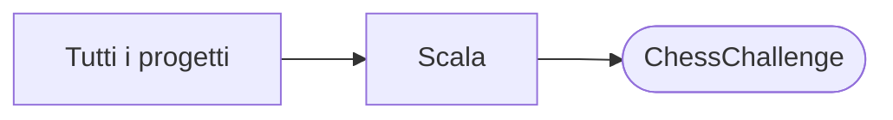

# ChessChallenge

[Tutti i progetti](../README.md)

> Voce di catalogo generata dai metadati di GitHub con `build_projects.py` (`just projects`). Non si modifica a mano.

| | |
|---|---|
| Repository | [pakkio/ChessChallenge](https://github.com/pakkio/ChessChallenge) |
| Linguaggio | Scala |
| Tipo | originale |
| Creato | 2015-06-15 |
| Ultimo push | 2025-12-31 |
| Dimensione | 29689 KB |

Testing Exercise proposed by TryCatchUs

## Dal suo README

> ChessChallenge - Exponential Performance Optimization Overview Chess piece placement solver achieving extraordinary performance improvements through systematic algorithmic optimization. Finds all valid non-attacking arrangements of chess pieces on M×N boards. Performance Achievement:

## Dove si colloca

