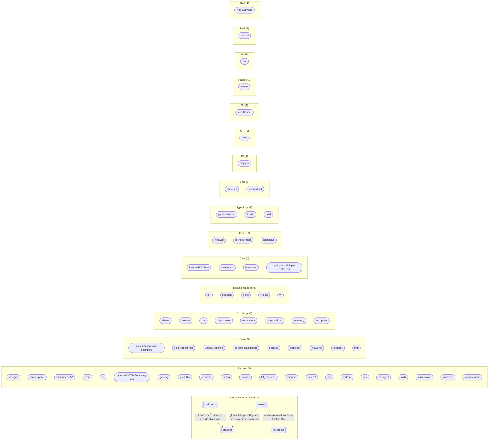

# Progetti

La mappa del lavoro su [github.com/pakkio](https://github.com/pakkio). Quattro progetti sono documentati in profondità, ciascuno come una piccola rete di pagine Markdown con grafi (★); ogni altro repository ha una pagina di catalogo generata da GitHub.

> Questo nodo è generato dai metadati di GitHub con `build_projects.py` (`just projects`). Non si modifica a mano.

## La mappa

Le linee tratteggiate sono relazioni più deboli (un formato condiviso, un posto dove girare); quelle piene sono dipendenze dirette.

## Documentati in profondità

- **[nexus](nexus/README.md)** — documentato da due lati: [motore e pipeline](nexus/ENGINE.md) e [lore](nexus/VEIL-WORLD.md)
- **[craftsim](craftsim/README.md)** — il fork di OpenSimulator ([architettura](craftsim/ARCHITECTURE.md), [flussi di lavoro](craftsim/WORKFLOWS.md))
- **[craftstorm](craftstorm/README.md)** — viewer e ponte per il browser ([architettura](craftstorm/ARCHITECTURE.md), [flussi di lavoro](craftstorm/WORKFLOWS.md))
- **[jev-pakkio](jev-pakkio/README.md)** — punteggio locale delle opzioni ([architettura](jev-pakkio/ARCHITECTURE.md), [flussi di lavoro](jev-pakkio/WORKFLOWS.md))

## Tutti i progetti

| Progetto | Linguaggio | Ultimo push | Descrizione |
|---|---|---|---|
| **[nexus](nexus/README.md)** ★ | Python | 2026-10-19 | Motore di RPG testuale basato su IA: NPC guidati da un LLM nel mondo di Eldoria, usabile da terminale, HTTP, MCP o OpenSim — [Ingresso](nexus/README.md) · [Motore](nexus/ENGINE.md) · [Pipeline](nexus/PIPELINE.md) · [Lore](nexus/VEIL-WORLD.md) |
| **[craftsim](craftsim/README.md)** ★ | — | privato | Fork di OpenSimulator su .NET 10: motore di script ZEngine, percorsi di servizio asincroni, moduli aggiuntivi, voce, strumenti operativi — [Ingresso](craftsim/README.md) · [Architettura](craftsim/ARCHITECTURE.md) · [Flussi di lavoro](craftsim/WORKFLOWS.md) |
| **[craftstorm](craftstorm/README.md)** ★ | — | privato | Fork del viewer Firestorm più un viewer da browser che si collega alla griglia via LLUDP — [Ingresso](craftstorm/README.md) · [Architettura](craftstorm/ARCHITECTURE.md) · [Flussi di lavoro](craftstorm/WORKFLOWS.md) |
| **[jev-pakkio](jev-pakkio/README.md)** ★ | Python | 2026-10-06 | Punteggio locale delle opzioni in un solo passaggio con Gemma 3 4B: CLI, server HTTP, strumenti MCP, motori System One, Jev-Mem — [Ingresso](jev-pakkio/README.md) · [Architettura](jev-pakkio/ARCHITECTURE.md) · [Flussi di lavoro](jev-pakkio/WORKFLOWS.md) |
| [ainews](ainews/README.md) | JavaScript | 2025-06-29 | AI Intelligence Platform Real-time AI news analysis and strategic intelligence synthesis platform that dynamic |
| [akka-http-streams-examples](akka-http-streams-examples/README.md) | Scala | 2016-08-08 | Akka HTTP microservice example This project demonstrates the Akka HTTP library and Scala to write a simple RES |
| [akka-stream-http](akka-stream-http/README.md) | Scala | 2016-09-24 | testing akka stream/http |
| [assegna](assegna/README.md) | Python | 2026-09-19 | assegna Workforce-to-place matching and reassignment toolkit. Files chat.py` -- simple terminal chat against t |
| [browser](browser/README.md) | JavaScript | 2026-01-05 | 🗂️ Modern File Browser A sleek, modern web-based file browser with support for multiple file types including P |
| [cck](cck/README.md) | JavaScript | 2026-10-18 | C# scripts for ChilloutVR worlds (CCK, Unity) that mimic Second Life LSL calls, plus the local tooling used to |
| [ChessChallenge](ChessChallenge/README.md) | Scala | 2025-12-31 | Testing Exercise proposed by TryCatchUs |
| [comics-panel](comics-panel/README.md) | Python | 2025-04-25 | Comic Panel Detector Detect and extract individual panels from scanned comic pages using classical computer‑vi |
| [edmondo-1252](edmondo-1252/README.md) | Python | 2016-08-08 | edmondo-1252 testing fork A very simple score keeper to help in building up small educational games in SecondL |
| [ernie](ernie/README.md) | Python | 2025-07-04 | Ernie Chat Interface A Gradio-based web interface for chatting with Baidu's Ernie 4.5 Turbo AI model. Features |
| [es](es/README.md) | Python | 2025-06-25 | The Everything Search Python Wrapper provides a fast and flexible interface to search through files on your sy |
| [firestormPOCJava](firestormPOCJava/README.md) | Java | 2026-06-07 | Firestorm Java POC Proof of Concept** — Implementazione Java di un viewer per **Second Life / OpenSim**, ispir |
| [FMM](FMM/README.md) | C++ | 2026-07-31 | Fast Multipole Method - Simulazione Gravitazionale 2D Implementazione del **Fast Multipole Method** in C++ con |
| [gemini-desktop](gemini-desktop/README.md) | TypeScript | 2025-06-26 | Gemini MCP Desktop Client Gemini MCP Desktop Client** is a desktop client built with Electron, Vite, React, an |
| [gemma3-270M-finetuning-ner](gemma3-270M-finetuning-ner/README.md) | Python | 2025-08-26 | 🎯 Gemma Models Training & Comparison Framework Panoramica del Progetto Framework completo per il fine-tuning e |
| [generic-scala-plugin](generic-scala-plugin/README.md) | Scala | 2026-10-18 | generic-scala-plugin Proof of concept: a Gerrit plugin written in Scala. `GenericPlugin` is a Guice-exported s |
| [gev-rag](gev-rag/README.md) | Python | 2026-10-03 | Tiny RAG + Jev A small, readable Retrieval-Augmented Generation (RAG) web app. You upload documents, ask quest |
| [hifi](hifi/README.md) | — | 2019-12-13 | Open source client/server software for creating shared VR environments. Docs at http://docs.highfidelity.com W |
| [javathreads](javathreads/README.md) | Java | 2026-10-18 | javathreads Java concurrency exercises (Maven, `threads/`): threads and runnables, executors, `synchronized`,  |
| [jev-biblio](jev-biblio/README.md) | Python | 2026-09-27 | 📚 Skepsis Harness Jev per verificare se le affermazioni di un testo sono sostenute dalle sue fonti. Dashboard  |
| [jev-news](jev-news/README.md) | Python | 2026-10-19 | search Small CLI scripts for web search via third-party APIs, and a Jev-based news digest built on top of them |
| [jHardware](jHardware/README.md) | Java | 2017-04-14 | Get crossplatform hardware details with Java |
| [llmrag](llmrag/README.md) | Python | 2025-06-21 | LLM RAG System A comprehensive Retrieval-Augmented Generation (RAG) system that processes PDF documents and pr |
| [llmwiki](llmwiki/README.md) | TypeScript | 2026-04-30 | llmwiki A Karpathy-style LLM-powered personal knowledge base. Paste or ingest any document and an agentic loop |
| [logparse](logparse/README.md) | Scala | 2016-08-08 | Simple log parsing code with Scala parser combinators |
| [logparser](logparser/README.md) | Scala | 2016-09-24 | Log parser in Scala for ant build results, log4j and logback |
| [logprob](logprob/README.md) | Python | 2025-06-30 | analisi di auutocertezze per ogni frase per i modelli openAI |
| [lsl_simulator](lsl_simulator/README.md) | Python | 2025-07-13 | LSL Simulator A production-ready Python implementation for parsing and simulating LSL (Linden Scripting Langua |
| [lslforge](lslforge/README.md) | Haskell | 2017-03-11 | LSLForge - maintaining recent LSL definitions fork |
| [mcp-blender](mcp-blender/README.md) | Go | 2026-09-23 | mcp-blender (v2.3.5) Exposes Blender to MCP clients (Claude Code, Claude Desktop, Antigravity, and others) thr |
| [mcp-cck](mcp-cck/README.md) | C# | 2026-09-13 | MCP Unity Editor (Game Engine) MCP Unity is an implementation of the Model Context Protocol for Unity Editor,  |
| [mcp-crawler](mcp-crawler/README.md) | JavaScript | 2026-10-18 | crawler |
| [mcp-dotenv](mcp-dotenv/README.md) | JavaScript | 2026-10-18 | mcp-dotenv MCP server to read and manage `.env` files and scan code for secrets **without exposing the values* |
| [mcp-local_llm](mcp-local_llm/README.md) | JavaScript | 2026-08-02 | local-llm MCP server that lets Claude Code delegate trivial, standalone questions to a local Gemma 4 model (vi |
| [mcp-wolfvoice](mcp-wolfvoice/README.md) | Rust | 2026-10-11 | wolfvoice Spatial WebRTC voice for OpenSimulator — one service that Firestorm and browser-based viewers both r |
| [mcpweb](mcpweb/README.md) | HTML | 2026-02-27 | mcpweb |
| [mondovirtuale](mondovirtuale/README.md) | HTML | 2025-09-23 | Mondo Virtuale Simple virtual world with procedural generation, WebSocket server-client architecture, and WASD |
| [mragent](mragent/README.md) | Python | 2026-07-05 | Lightweight LLM agent with graph-based memory and hybrid retrieval (FTS5 BM25 + embeddings + RRF + rerank) on  |
| [nexus2](nexus2/README.md) | Python | 2026-10-18 | nexus2 AI-powered text RPG engine set in the fantasy world of Eldoria, designed to run NPCs inside a Second Li |
| [obsidian](obsidian/README.md) | — | 2026-10-18 | obsidian Obsidian vault documenting all projects of github.com/pakkio. Projects.md` – map of content, one link |
| [ocr](ocr/README.md) | Python | 2025-06-24 | 🚀 Advanced OCR Benchmark Suite A comprehensive comparison system for traditional OCR vs modern Vision Language |
| [ocrlocal](ocrlocal/README.md) | Python | 2026-10-18 | marker Pipeline locale PDF → Markdown con descrizione automatica delle figure via LLM vision. Stack:** Marker  |
| [oslsl](oslsl/README.md) | TypeScript | 2025-07-17 | LSL MCP Server A specialized Model Context Protocol (MCP) server for LSL (Linden Scripting Language) and OpenS |
| [pak](pak/README.md) | Python | 2025-08-07 | pak, impacchetta un intero folder per analizzarlo con AI |
| [pakagent](pakagent/README.md) | Python | 2025-06-22 | PakAgent A secure, enterprise-grade 5-program workflow system for LLM-assisted code development using pak tool |
| [pluto](pluto/README.md) | — | 2026-10-18 | pluto Placeholder repository with two small text files (`pippo`, `pluto`). Nothing to run. |
| [project](project/README.md) | — | 2026-10-18 | project Placeholder repository with a single test file. Nothing to run. |
| [quizhud](quizhud/README.md) | PHP | 2016-09-24 | Quizhud (Educational tool for Second Life/OpenSim) starting from http://quizhud.avid-insight.co.uk/ |
| [restclient](restclient/README.md) | Shell | 2017-12-31 | restclient Simplest client possible with RestTemplate and Spring Boot |
| [RxGame](RxGame/README.md) | Scala | 2016-08-08 | Simple Rx Platform Game |
| [schoolsafe](schoolsafe/README.md) | HTML | 2026-10-18 | SchoolSafe Single-page HTML app: a school evacuation simulation ('SchoolSafe — Simulazione Evacuazione Scolast |
| [skeleton](skeleton/README.md) | Scala | 2016-09-24 | Simple Scala project template |
| [skills](skills/README.md) | Python | 2026-08-02 | skills Agent skills for Claude Code / Freebuff-style agents. verbosity-control (trigger: `/terse`) Stops reaso |
| [soup-pakkio](soup-pakkio/README.md) | Python | 2026-10-05 | soup-pakkio A small demo of Soup (a CLI for fine-tuning LLMs) on a GTX 1080 (8 GB), plus a retrieval (RAG) alt |
| [spring-boot-h2-jpa-restserver](spring-boot-h2-jpa-restserver/README.md) | Java | 2026-10-18 | spring-boot-h2-jpa-restserver Minimal Spring Boot REST server backed by H2 via Spring Data JPA: an `Articolo`  |
| [summary](summary/README.md) | JavaScript | 2024-07-03 | LMStudio Summarizer LMStudio Summarizer è un'estensione per Chrome progettata per riassumere il contenuto dell |
| [tmp](tmp/README.md) | Scala | 2017-09-07 | reamde |
| [unirestclient](unirestclient/README.md) | Shell | 2017-12-31 | restclient Simplest client possible with RestTemplate and Spring Boot |
| [vibevoice](vibevoice/README.md) | Python | 2025-12-30 | 🎙️ VibeVoice: Open-Source Frontier Voice AI 📰 News 2025-12-16: 📣 We added more experimental speakers for explo |
| [vr](vr/README.md) | — | 2026-10-18 | Empty placeholder repository for virtual reality experiments (2017). See craftstorm for current virtual-world  |
| [wiki](wiki/README.md) | Lua | 2017-03-13 | In-game Wiki for Minetest |
| [wordpress](wordpress/README.md) | JavaScript | 2026-10-18 | wordpress MCP server for managing a WordPress site (posts, categories, tags) from an MCP client. Two implement |
| [youtube-news](youtube-news/README.md) | Python | 2025-10-12 | YouTube AI News Analysis System A comprehensive system for analyzing AI and technology YouTube videos using ad |
