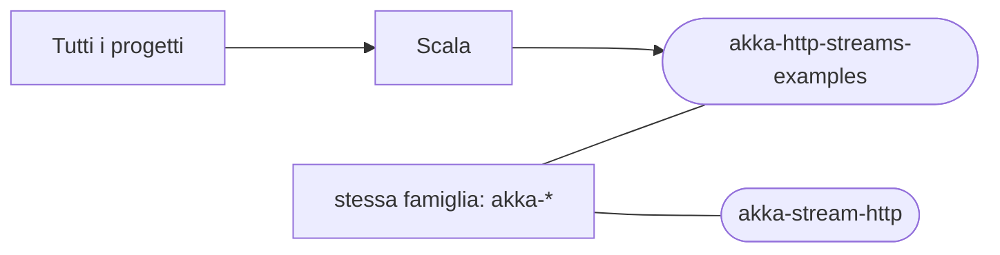

# akka-http-streams-examples

[Tutti i progetti](../README.md)

> Voce di catalogo generata dai metadati di GitHub con `build_projects.py` (`just projects`). Non si modifica a mano.

| | |
|---|---|
| Repository | [pakkio/akka-http-streams-examples](https://github.com/pakkio/akka-http-streams-examples) |
| Linguaggio | Scala |
| Tipo | originale |
| Creato | 2015-02-22 |
| Ultimo push | 2016-08-08 |
| Licenza | MIT |
| Dimensione | 1015 KB |

## Dal suo README

> Akka HTTP microservice example This project demonstrates the Akka HTTP library and Scala to write a simple REST (micro)service. The project shows the following tasks that are typical for most Akka HTTP-based projects: starting standalone HTTP server, handling file-based configuration,

## Dove si colloca

Stessa famiglia (prefisso del nome in comune): [akka-stream-http](../akka-stream-http/README.md)
