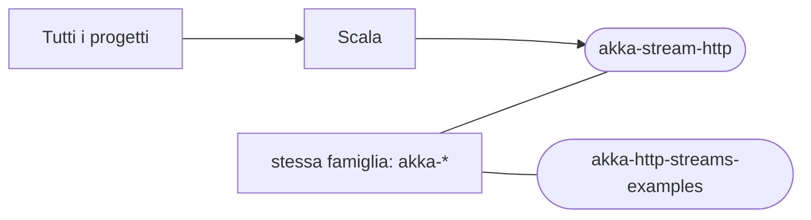

# akka-stream-http

[Tutti i progetti](../README.md)

> Voce di catalogo generata dai metadati di GitHub con `build_projects.py` (`just projects`). Non si modifica a mano.

| | |
|---|---|
| Repository | [pakkio/akka-stream-http](https://github.com/pakkio/akka-stream-http) |
| Linguaggio | Scala |
| Tipo | originale |
| Creato | 2015-05-23 |
| Ultimo push | 2016-09-24 |
| Dimensione | 27 KB |

testing akka stream/http

## Dal suo README

> akka-stream-http This is just a playground to test what Roland Kuhn showed in his demo at ScalaDays 2015 in March. I discovered that many things changed and need to practice these concepts. Also I followed the Streams cookbook http://doc.akka.io/docs/akka-stream-and-http-experimental/1.0-RC3/scala/stream-cookbook.html

## Dove si colloca

Stessa famiglia (prefisso del nome in comune): [akka-http-streams-examples](../akka-http-streams-examples/README.md)
