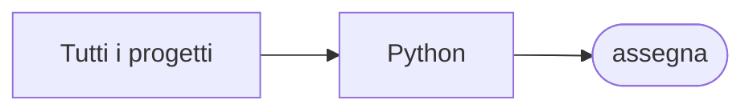

# assegna

[Tutti i progetti](../README.md)

> Voce di catalogo generata dai metadati di GitHub con `build_projects.py` (`just projects`). Non si modifica a mano.

| | |
|---|---|
| Repository | [pakkio/assegna](https://github.com/pakkio/assegna) |
| Linguaggio | Python |
| Tipo | originale |
| Creato | 2026-09-19 |
| Ultimo push | 2026-09-19 |
| Dimensione | 88 KB |

## Dal suo README

> assegna Workforce-to-place matching and reassignment toolkit. Files chat.py` -- simple terminal chat against the OpenCode Go LLM gateway.

## Dove si colloca

