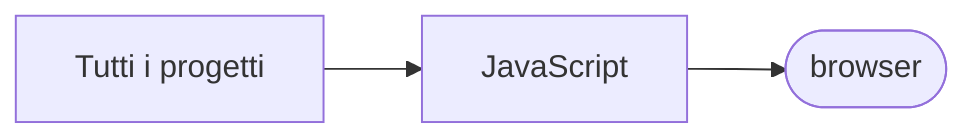

# browser

[Tutti i progetti](../README.md)

> Voce di catalogo generata dai metadati di GitHub con `build_projects.py` (`just projects`). Non si modifica a mano.

| | |
|---|---|
| Repository | [pakkio/browser](https://github.com/pakkio/browser) |
| Linguaggio | JavaScript |
| Tipo | originale |
| Creato | 2025-06-26 |
| Ultimo push | 2026-01-05 |
| Dimensione | 876 KB |

## Dal suo README

> 🗂️ Modern File Browser A sleek, modern web-based file browser with support for multiple file types including PDFs and comic book archives. Built with Node.js and Express, featuring a stunning glassmorphism UI. ✨ Features 🔐 Authentication Control

## Dove si colloca

