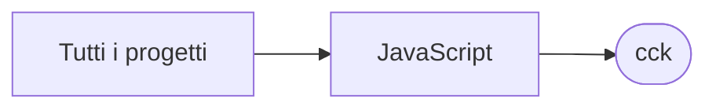

# cck

[Tutti i progetti](../README.md)

> Voce di catalogo generata dai metadati di GitHub con `build_projects.py` (`just projects`). Non si modifica a mano.

| | |
|---|---|
| Repository | [pakkio/cck](https://github.com/pakkio/cck) |
| Linguaggio | JavaScript |
| Tipo | originale |
| Creato | 2026-09-12 |
| Ultimo push | 2026-10-18 |
| Licenza | MIT |
| Dimensione | 14302 KB |

## Dal suo README

> C# scripts for ChilloutVR worlds (CCK, Unity) that mimic Second Life LSL calls, plus the local tooling used to drive Blender and Unity from an AI coding client over MCP. LSL equivalents for Unity / CCK CckChatLogger` is a base class: there is no universal CCK chat API, so to post into the

## Dove si colloca

