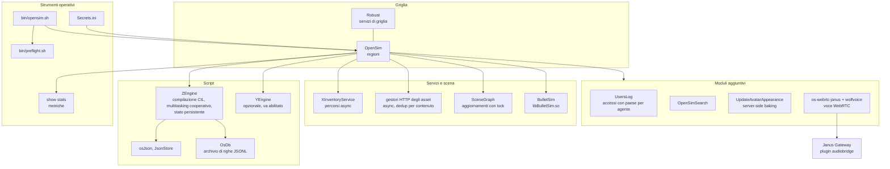
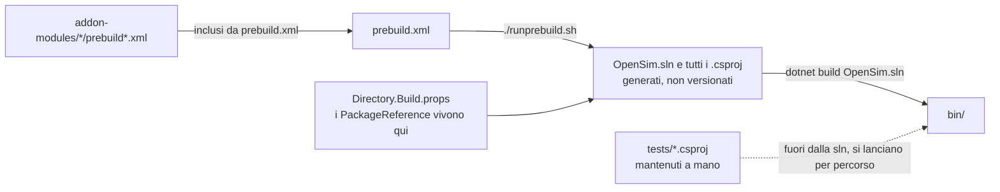

# craftsim: architettura

[Tutti i progetti](../README.md) · [craftsim](README.md) · [architettura](ARCHITECTURE.md) · [flussi di lavoro](WORKFLOWS.md)

Cosa craftsim aggiunge o cambia rispetto a OpenSimulator, e come i pezzi si parlano. Le fonti sono i documenti del repository
(`README.md`, `CRAFTSIM.md`, `CLAUDE.md`, `ZENGINE_ANNOUNCEMENT.md`); i numeri citati sono misure storiche dichiarate come tali.

## I pezzi

| Componente | Cosa fa | Note |
|---|---|---|
| **ZEngine** | Motore di script che compila in CIL (JIT) invece di interpretare | Multitasking cooperativo (niente fame di thread), persistenza dello stato, parità comportamentale dichiarata al 100% con il motore precedente; sintassi moderna ed estensioni `ZEXT` |
| **Percorsi asincroni** | Parti selezionate di `XInventoryService` e dei gestori HTTP degli asset usano `async`/`await` | Il beneficio dipende da latenza e concorrenza; non tutto OpenSim è asincrono |
| **Sicurezza dei thread** | Protezioni di rientranza negli aggiornamenti di `SceneGraph` | Evita che lotti di aggiornamento si sovrappongano e corrompano gli oggetti |
| **Asset indirizzati per contenuto** | Deduplicazione degli asset | Un contenuto uguale si memorizza una volta sola |
| **osJson / JsonStore** | Manipolazione di dati strutturati dagli script | Va abilitato in `[JsonStore]`; il preflight avvisa se gli script lo usano e non lo è |
| **OsDb** | Archivio di righe JSONL "in stile SQL" per gli script | |
| **Metriche** | Statistiche in tempo reale (`show stats`) | |
| **BulletSim** | Fisica; `libBulletSim.so` ottimizzata | Richiede lo shim `libwrap_memcpy.so` via `LD_PRELOAD`, impostato da `bin/opensim.sh` |
| **Server-side baking (shim)** | `UpdateAvatarAppearanceModule` registra la capability `UpdateAvatarAppearance` | Solo del fork; componi le texture dei wearable sul server; attivabile con `EnableServerSideBakingShim` |
| **UsersLog** | Registra gli accessi con paese per agente (JSON, SQLite o MySQL) | Spento di default; richiede il database GeoLite2 di MaxMind messo a parte in `bin/data/` |
| **OpenSimSearch** | Ricerca (`[Search]`) | Spento di default |
| **Voce WebRTC** | Addon `os-webrtc-janus` con `wolfvoice`, dietro Janus Gateway | Setup in `JANUS-SETUP.md`, piano di test in `TEST-PLAN-VOICE.md` |
| **Segreti** | `Secrets.ini` | Esiste un `Secrets.ini.example` da cui partire |

## Runtime e memoria

Il codice punta a .NET 10 (SDK fissato in `global.json`, `10.0.100` con `rollForward: latestPatch`). Per questo carico di lavoro si
usa il **Workstation GC**: il Server GC è stato misurato e scartato (un solo ciclo di heartbeat della scena più pochi thread di
script). Misure storiche su .NET 9: avvio in circa 1,5 secondi e circa 161 MB di memoria residente a riposo; non sono state
rifatte su .NET 10.

## Il sistema di build

Un modulo messo in `addon-modules/` compare nella soluzione soltanto rieseguendo `./runprebuild.sh`. I pacchetti NuGet vanno
dichiarati in `Directory.Build.props`, mai in un `.csproj`: prebuild rigenera i progetti e li perderebbe.
