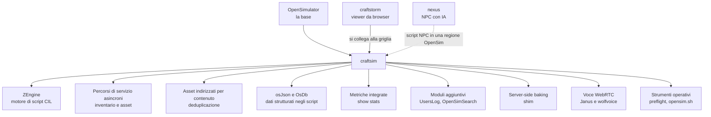

# craftsim

[Tutti i progetti](../README.md) · [craftsim](README.md) · [architettura](ARCHITECTURE.md) · [flussi di lavoro](WORKFLOWS.md)

Un fork di **OpenSimulator** ("CraftSim: the Next Generation OpenSimulator") concentrato sull'esecuzione degli script, sui
percorsi di servizio asincroni, sulla diagnostica a runtime, sull'archiviazione degli asset e sulle prestazioni di
deployment. Il codice punta a **.NET 10**; le misure storiche nei documenti vengono da build .NET 8 e 9 e non sono state rifatte
su .NET 10. Repository privato: [github.com/pakkio/craftsim](https://github.com/pakkio/craftsim) (circa 1900 file C#, 39 script
Python, 21 script di shell; ultimo commit 2026-10-18).

Il filo comune: più prestazioni dove si misura davvero (script, I/O dei servizi), strumenti per vedere cosa succede (metriche,
controlli prima dell'avvio), e un deploy ripetibile.

## Dove leggere

| Pagina | Cosa contiene |
|---|---|
| [Architettura](ARCHITECTURE.md) | I componenti aggiunti a OpenSim e come si collegano |
| [Flussi di lavoro](WORKFLOWS.md) | Compilare, testare, avviare una griglia, mettere in produzione la voce |

## I documenti del repository

| File | Contenuto |
|---|---|
| [`README.md`](https://github.com/pakkio/craftsim/blob/HEAD/README.md) | Miglioramenti rispetto a OpenSim ufficiale, differenze di configurazione, metriche, avvio rapido (molto lungo) |
| [`CRAFTSIM.md`](https://github.com/pakkio/craftsim/blob/HEAD/CRAFTSIM.md) | Migrazione di runtime, percorsi asincroni, sicurezza dei thread, risultati con NPC, benchmark con 1000 script e 100 NPC, sintassi ZEXT |
| [`CLAUDE.md`](https://github.com/pakkio/craftsim/blob/HEAD/CLAUDE.md) | Stato, comandi di build, strumenti operativi, moduli aggiuntivi, segreti, voce, trabocchetti noti |
| [`BUILDING.md`](https://github.com/pakkio/craftsim/blob/HEAD/BUILDING.md) | Compilare su Windows, Linux e macOS |
| [`SELF_HOSTING.md`](https://github.com/pakkio/craftsim/blob/HEAD/SELF_HOSTING.md) | Mettere in piedi una griglia (Robust + OpenSim) |
| [`JANUS-SETUP.md`](https://github.com/pakkio/craftsim/blob/HEAD/JANUS-SETUP.md) | Janus Gateway per la voce WebRTC |
| [`TEST-PLAN-VOICE.md`](https://github.com/pakkio/craftsim/blob/HEAD/TEST-PLAN-VOICE.md) | Piano di test della voce su una singola regione di produzione |
| [`ZENGINE_ANNOUNCEMENT.md`](https://github.com/pakkio/craftsim/blob/HEAD/ZENGINE_ANNOUNCEMENT.md) | Perché ZEngine, in italiano |
| [`AGENTS.md`](https://github.com/pakkio/craftsim/blob/HEAD/AGENTS.md) | Istruzioni per gli agenti, compreso l'accesso live al simulatore con `mcp-craftsim` |
