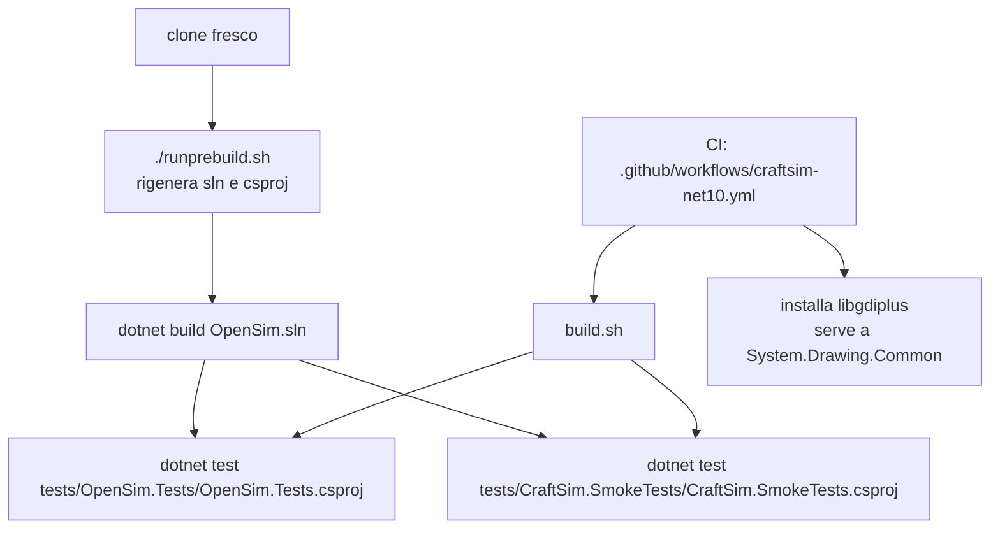
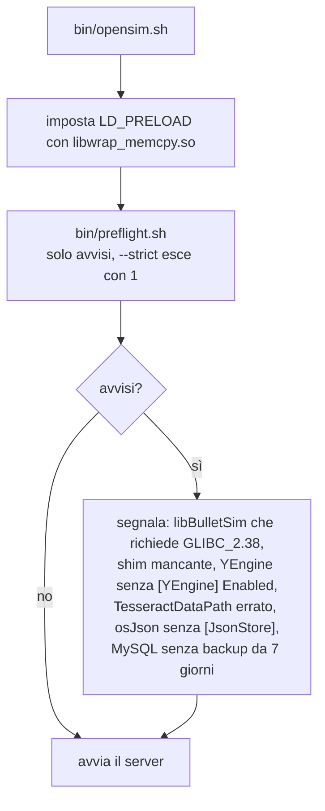
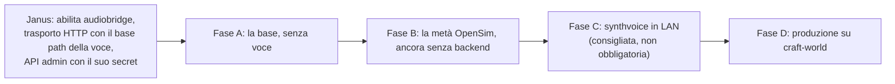

# craftsim: flussi di lavoro

[Tutti i progetti](../README.md) · [craftsim](README.md) · [architettura](ARCHITECTURE.md) · [flussi di lavoro](WORKFLOWS.md)

I percorsi pratici: compilare e testare, mettere su una griglia, avviare con i controlli, portare la voce in produzione.
Le fonti sono `CLAUDE.md`, `BUILDING.md`, `SELF_HOSTING.md`, `JANUS-SETUP.md` e `TEST-PLAN-VOICE.md` del repository.

## Compilare e testare

- `./runprebuild.sh` è il **primo comando su un clone fresco**: `OpenSim.sln` e i progetti generati non sono versionati.
- I progetti di test **non sono nella soluzione**, quindi `dotnet build OpenSim.sln` non li compila: si lanciano per percorso.
- Ultima verifica registrata in `CLAUDE.md`: compilazione senza errori né avvisi; test `OpenSim.Tests` 477/479 più 2/2 di
  `CraftSim.SmokeTests`. L'unico test che fallisce nell'esecuzione completa dipende dal carico e passa da solo.
- Una versione dell'SDK `10.0.3xx` **non** soddisfa `global.json`: serve un SDK della fascia `10.0.1xx`.

## Mettere su una griglia

L'ordine conta: Robust prima, OpenSim dopo. `SELF_HOSTING.md` descrive anche il trabocchetto della `DefaultRegion` e chi può davvero
raggiungere la griglia in rete.

## Avviare con i controlli

Si avvia con `bin/opensim.sh`, non con un semplice `dotnet OpenSim.dll`: senza lo shim la fisica fallisce con
`undefined symbol: __wrap_memcpy`.

## Voce WebRTC in produzione

`TEST-PLAN-VOICE.md` elenca le decisioni già prese, un interludio su Rust per chi non lo conosce, e cosa il test **non** copre.
`JANUS-SETUP.md` spiega la corrispondenza tra le due configurazioni (Janus e OpenSim) e i messaggi d'errore più comuni.

## Lavorare con un agente

`AGENTS.md` descrive due cose: gli strumenti MCP per accedere al simulatore in funzione (`mcp-craftsim`) e l'architettura del
progetto con i trabocchetti di build. `CLAUDE.md` tiene lo stato aggiornato (versione, configurazione, controlli aperti).
