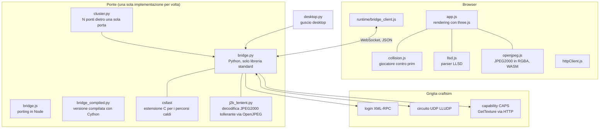
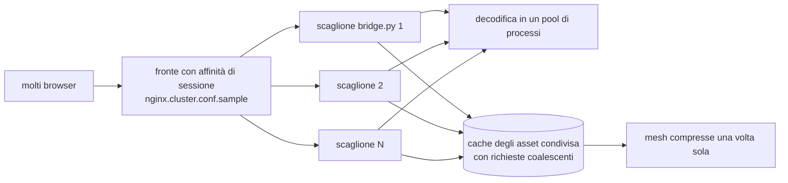

# craftstorm: architettura

[Tutti i progetti](../README.md) · [craftstorm](README.md) · [architettura](ARCHITECTURE.md) · [flussi di lavoro](WORKFLOWS.md)

Due metà: il viewer Firestorm, ereditato, e `web/`, il viewer da browser con il suo ponte. Quasi tutto il lavoro recente è in `web/`.

## Il viewer da browser

## Perché esiste il ponte

- Il protocollo reale (movimento, chat, aggiornamenti degli oggetti, tocco, sedersi) è UDP (LLUDP), e un browser non può usarlo.
- Il ponte fa il login tramite il servizio XML-RPC della griglia, apre il circuito UDP con il simulatore usando il formato dei
  messaggi del viewer (`message_template.msg`), e offre al browser un protocollo JSON su un server WebSocket scritto a mano.
- Le texture arrivano dalla capability `GetTexture` (negoziata dal seed CAPS ottenuto al login) e vanno decodificate da JPEG2000,
  perché il browser non sa farlo. La decodifica passa da `imagecodecs` (OpenJPEG), non da Pillow: le texture dei corpi di questa
  griglia sono flussi J2K grezzi con una quinta componente (una maschera ausiliaria) che Pillow rifiuta.

## Prestazioni: la scalabilità del ponte

Un ponte Python è un solo processo, quindi la parte di `web/` più curata è la scalabilità.

Dalla cronologia dei commit: scaglioni dietro un fronte con affinità, decodifica in un pool di processi, cache degli asset condivisa
con coalescenza delle richieste, mesh compresse una volta sola e condivise tra richieste concorrenti, `orjson`, un'estensione C
(`csfast`) per i percorsi caldi, un lettore persistente sul socket del simulatore e arrotondamenti esatti veloci.

## Il viewer Firestorm

`indra/` contiene il codice del viewer (C++), `scripts/` e `autobuild.xml` gli strumenti di build, `doc/` le istruzioni per
Windows, macOS e Linux. È la base ufficiale di Firestorm; il lavoro specifico di craftstorm è in `web/`.
