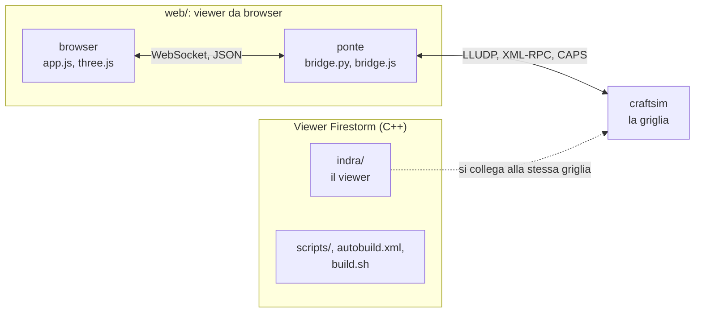

# craftstorm

[Tutti i progetti](../README.md) · [craftstorm](README.md) · [architettura](ARCHITECTURE.md) · [flussi di lavoro](WORKFLOWS.md)

Un fork del viewer **Firestorm** (il client per mondi 3D come Second Life e le griglie OpenSim) con in più una cartella `web/`: un
**viewer da browser** per la griglia di craftsim. Un browser non sa parlare UDP, e il protocollo di OpenSim/Second Life (LLUDP) è
UDP; la parte di `web/` che manca a un browser è un **ponte** che fa il login, apre il circuito UDP con il simulatore e
ri-espone tutto al browser come un piccolo protocollo JSON su WebSocket.
Repository privato: [github.com/pakkio/craftstorm](https://github.com/pakkio/craftstorm); ultimo commit 2026-10-18, tutti dedicati a
`web/` (prestazioni e stabilità del ponte).

## Dove leggere

| Pagina | Cosa contiene |
|---|---|
| [Architettura](ARCHITECTURE.md) | Il viewer, il ponte, i moduli del browser, la versione a scaglioni |
| [Flussi di lavoro](WORKFLOWS.md) | Avviare il ponte, compilare le parti in C, testare, l'elenco delle correzioni previste |

## I documenti del repository

| File | Contenuto |
|---|---|
| [`README.md`](https://github.com/pakkio/craftstorm/blob/HEAD/README.md) | Il README di Firestorm: scaricare, compilare (Windows, macOS, Linux), contribuire |
| [`CONTRIBUTING.md`](https://github.com/pakkio/craftstorm/blob/HEAD/CONTRIBUTING.md) | Linee guida per le pull request di Firestorm |
| [`AGENTS.md`](https://github.com/pakkio/craftstorm/blob/HEAD/AGENTS.md), [`GEMINI.md`](https://github.com/pakkio/craftstorm/blob/HEAD/GEMINI.md) | Permessi e operazioni che un agente può fare da solo o solo con conferma |
| [`web/HANDOVER_TODO.md`](https://github.com/pakkio/craftstorm/blob/HEAD/web/HANDOVER_TODO.md) | Revisione della stabilità del 2026-09-08: dodici difetti e un problema di durata delle risorse, con l'ordine di correzione |
