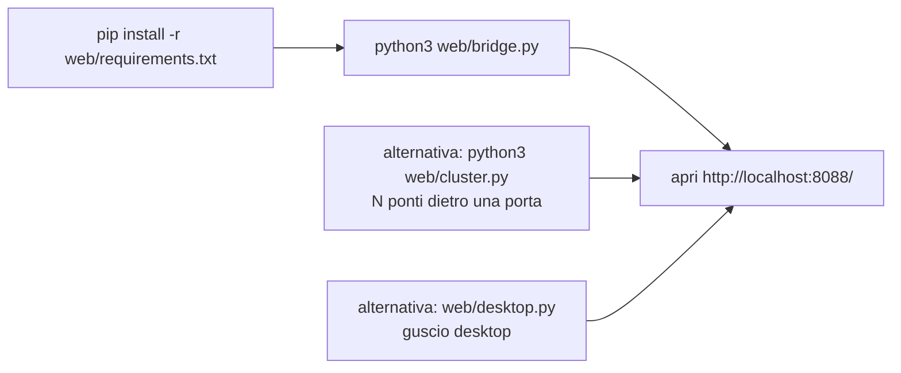
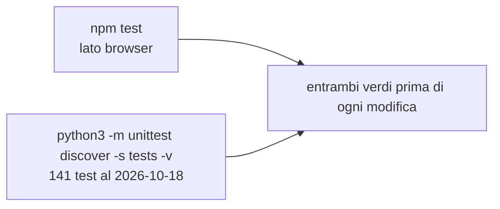
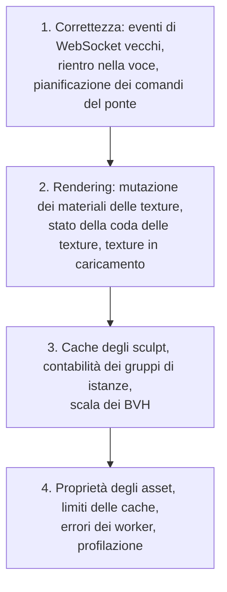

# craftstorm: flussi di lavoro

[Tutti i progetti](../README.md) · [craftstorm](README.md) · [architettura](ARCHITECTURE.md) · [flussi di lavoro](WORKFLOWS.md)

## Avviare il viewer da browser

Il ponte richiede le dipendenze Python elencate in `web/requirements.txt` (per esempio `imagecodecs`); `bridge.js` è un porting in Node.

## Le parti in C e compilate

Le ricette del `justfile` in `web/`:

| Ricetta | Cosa fa |
|---|---|
| `build-bridge-c` / `clean-bridge-c` | Compila (o pulisce) la versione Cython del ponte |
| `run-compiled` | Esegue il ponte compilato (`bridge_compiled.py`) |
| `test-compiled` | Esegue i test sul ponte compilato |
| `build-fast` / `clean-fast` | Compila (o pulisce) l'estensione C `csfast` dei percorsi caldi |

## Testare

## L'elenco delle correzioni previste

`web/HANDOVER_TODO.md` raccoglie i difetti trovati nella revisione del 2026-09-08, in ordine di intervento e senza accorparli:

Ogni voce ha una condizione di accettazione verificabile da sola; le riproduzioni temporanee vanno trasformate in test di regressione
committati prima di correggere.

## Compilare il viewer Firestorm

Le istruzioni per sistema operativo stanno in `doc/building_windows.md`, `doc/building_macos.md` e `doc/building_linux.md`; per
contribuire, `CONTRIBUTING.md`. Il progetto Firestorm non offre supporto per chi compila da sé.
