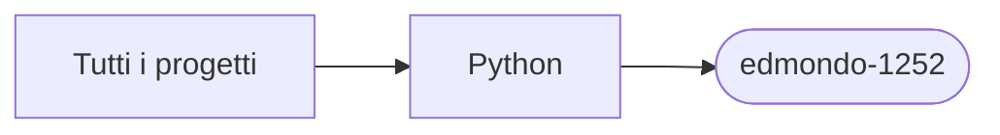

# edmondo-1252

[Tutti i progetti](../README.md)

> Voce di catalogo generata dai metadati di GitHub con `build_projects.py` (`just projects`). Non si modifica a mano.

| | |
|---|---|
| Repository | [pakkio/edmondo-1252](https://github.com/pakkio/edmondo-1252) |
| Linguaggio | Python |
| Tipo | fork |
| Creato | 2016-06-14 |
| Ultimo push | 2016-08-08 |
| Dimensione | 6 KB |

## Dal suo README

> edmondo-1252 testing fork A very simple score keeper to help in building up small educational games in SecondLife, OpenSim or other virtual worlds, or for any games.

## Dove si colloca

