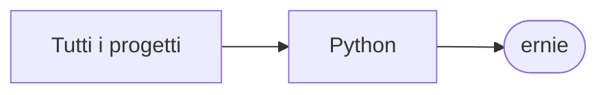

# ernie

[Tutti i progetti](../README.md)

> Voce di catalogo generata dai metadati di GitHub con `build_projects.py` (`just projects`). Non si modifica a mano.

| | |
|---|---|
| Repository | [pakkio/ernie](https://github.com/pakkio/ernie) |
| Linguaggio | Python |
| Tipo | originale |
| Creato | 2025-07-01 |
| Ultimo push | 2025-07-04 |
| Dimensione | 54 KB |

## Dal suo README

> Ernie Chat Interface A Gradio-based web interface for chatting with Baidu's Ernie 4.5 Turbo AI model. Features Real-time streaming chat** with Ernie 4.5 Turbo

## Dove si colloca

