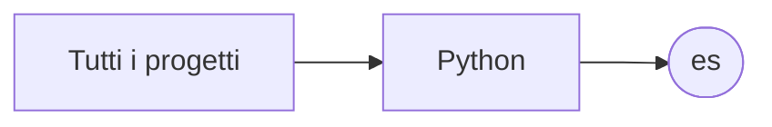

# es

[Tutti i progetti](../README.md)

> Voce di catalogo generata dai metadati di GitHub con `build_projects.py` (`just projects`). Non si modifica a mano.

| | |
|---|---|
| Repository | [pakkio/es](https://github.com/pakkio/es) |
| Linguaggio | Python |
| Tipo | originale |
| Creato | 2025-06-25 |
| Ultimo push | 2025-06-25 |
| Licenza | MIT |
| Dimensione | 150 KB |

## Dal suo README

> The Everything Search Python Wrapper provides a fast and flexible interface to search through files on your system. Everything Search Python Wrapper A comprehensive Python wrapper for Everything Search (es.exe) command-line tool by voidtools. Everything Search is an extremely fast file and folder search utility for Windows. This wrapper provides a Pythonic interface to harness its power programmatically.

## Dove si colloca

