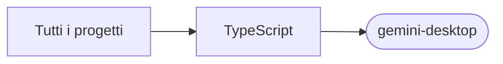

# gemini-desktop

[Tutti i progetti](../README.md)

> Voce di catalogo generata dai metadati di GitHub con `build_projects.py` (`just projects`). Non si modifica a mano.

| | |
|---|---|
| Repository | [pakkio/gemini-desktop](https://github.com/pakkio/gemini-desktop) |
| Linguaggio | TypeScript |
| Tipo | originale |
| Creato | 2025-06-26 |
| Ultimo push | 2025-06-26 |
| Licenza | GPL-3.0 |
| Dimensione | 34941 KB |

## Dal suo README

> Gemini MCP Desktop Client Gemini MCP Desktop Client** is a desktop client built with Electron, Vite, React, and TypeScript, designed to interact with various Model Context Protocol (MCP) servers. It also integrates Google's Gemini API to provide a powerful LLM chat experience. 🖼️ App Screenshot

## Dove si colloca

