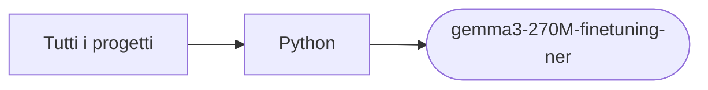

# gemma3-270M-finetuning-ner

[Tutti i progetti](../README.md)

> Voce di catalogo generata dai metadati di GitHub con `build_projects.py` (`just projects`). Non si modifica a mano.

| | |
|---|---|
| Repository | [pakkio/gemma3-270M-finetuning-ner](https://github.com/pakkio/gemma3-270M-finetuning-ner) |
| Linguaggio | Python |
| Tipo | originale |
| Creato | 2025-08-17 |
| Ultimo push | 2025-08-26 |
| Dimensione | 145496 KB |

## Dal suo README

> 🎯 Gemma Models Training & Comparison Framework Panoramica del Progetto Framework completo per il fine-tuning e confronto di modelli **Gemma3 (270M & 1B)** vs **CodeS-1B** su multiple task NLP. Include ottimizzazioni per GPU consumer (4-8GB VRAM) con quantizzazione 4-bit e supporto LoRA. 🆕 Nuove Funzionalità - Gemma3 1B

## Dove si colloca

