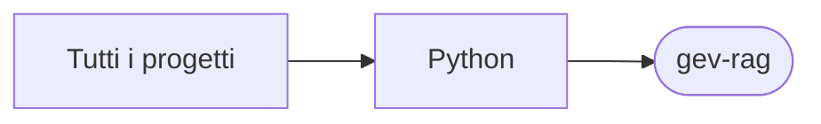

# gev-rag

[Tutti i progetti](../README.md)

> Voce di catalogo generata dai metadati di GitHub con `build_projects.py` (`just projects`). Non si modifica a mano.

| | |
|---|---|
| Repository | [pakkio/gev-rag](https://github.com/pakkio/gev-rag) |
| Linguaggio | Python |
| Tipo | originale |
| Creato | 2026-09-27 |
| Ultimo push | 2026-10-03 |
| Dimensione | 124 KB |

## Dal suo README

> Tiny RAG + Jev A small, readable Retrieval-Augmented Generation (RAG) web app. You upload documents, ask questions, and get answers with citations. The right-hand panel shows each pipeline step: its timing, inputs and outputs.

## Dove si colloca

