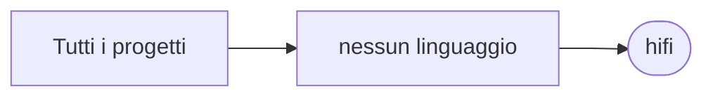

# hifi

[Tutti i progetti](../README.md)

> Voce di catalogo generata dai metadati di GitHub con `build_projects.py` (`just projects`). Non si modifica a mano.

| | |
|---|---|
| Repository | [pakkio/hifi](https://github.com/pakkio/hifi) |
| Linguaggio | — |
| Tipo | fork |
| Creato | 2019-12-13 |
| Ultimo push | 2019-12-13 |
| Dimensione | 1033021 KB |

Open source client/server software for creating shared VR environments.  Docs at http://docs.highfidelity.com  We are hiring: http://highfidelity.com/jobs  Also, PT work available at http://worklist.net

## Dal suo README

> High Fidelity (hifi) is an early-stage technology lab experimenting with Virtual Worlds and VR. This repository contains the source to many of the components in our alpha-stage virtual world. The project embraces distributed development. If you find a small bug and have a fix, pull requests are welcome.

## Dove si colloca

