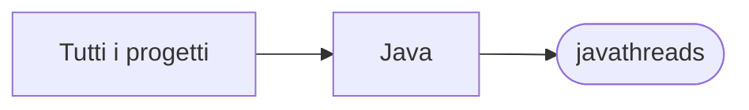

# javathreads

[Tutti i progetti](../README.md)

> Voce di catalogo generata dai metadati di GitHub con `build_projects.py` (`just projects`). Non si modifica a mano.

| | |
|---|---|
| Repository | [pakkio/javathreads](https://github.com/pakkio/javathreads) |
| Linguaggio | Java |
| Tipo | originale |
| Creato | 2019-03-26 |
| Ultimo push | 2026-10-18 |
| Dimensione | 50 KB |

## Dal suo README

> javathreads Java concurrency exercises (Maven, `threads/`): threads and runnables, executors, `synchronized`, locks, semaphores, deadlock and bank-transfer examples, Java 7 vs Java 8 tasks, concurrent maps and a parallel Pi estimation (`pirandom`).

## Dove si colloca

