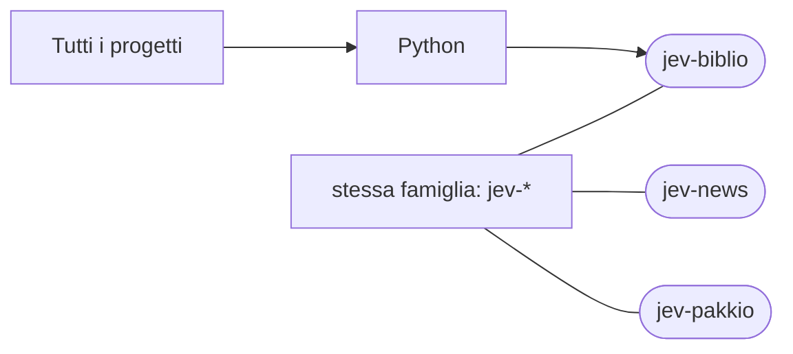

# jev-biblio

[Tutti i progetti](../README.md)

> Voce di catalogo generata dai metadati di GitHub con `build_projects.py` (`just projects`). Non si modifica a mano.

| | |
|---|---|
| Repository | [pakkio/jev-biblio](https://github.com/pakkio/jev-biblio) |
| Linguaggio | Python |
| Tipo | originale |
| Creato | 2026-09-25 |
| Ultimo push | 2026-09-27 |
| Dimensione | 379 KB |

## Dal suo README

> 📚 Skepsis Harness Jev per verificare se le affermazioni di un testo sono sostenute dalle sue fonti. Dashboard web locale che controlla se un articolo è davvero sostenuto dalle sue fonti: verifica i link** della bibliografia e **scarica il testo delle fonti**;

## Dove si colloca

Stessa famiglia (prefisso del nome in comune): [jev-news](../jev-news/README.md), [jev-pakkio](../jev-pakkio/README.md)
