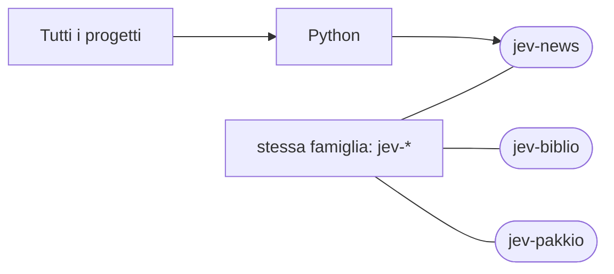

# jev-news

[Tutti i progetti](../README.md)

> Voce di catalogo generata dai metadati di GitHub con `build_projects.py` (`just projects`). Non si modifica a mano.

| | |
|---|---|
| Repository | [pakkio/jev-news](https://github.com/pakkio/jev-news) |
| Linguaggio | Python |
| Tipo | originale |
| Creato | 2026-09-29 |
| Ultimo push | 2026-10-19 |
| Dimensione | 471 KB |

## Dal suo README

> search Small CLI scripts for web search via third-party APIs, and a Jev-based news digest built on top of them. Scripts

## Dove si colloca

Stessa famiglia (prefisso del nome in comune): [jev-biblio](../jev-biblio/README.md), [jev-pakkio](../jev-pakkio/README.md)
