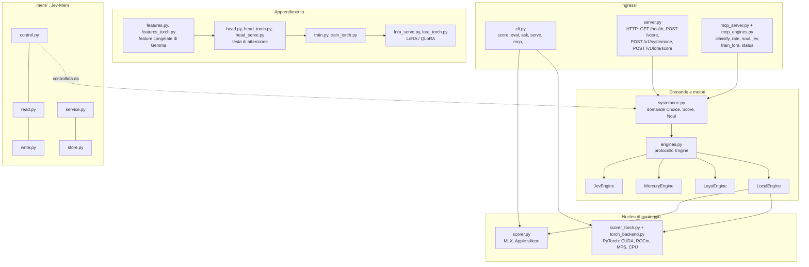

# jev-pakkio: architettura

[Tutti i progetti](../README.md) · [jev-pakkio](README.md) · [architettura](ARCHITECTURE.md) · [flussi di lavoro](WORKFLOWS.md)

Il pacchetto `jev_pakkio/` e ciò che gli sta attorno. Le fonti sono il codice e `docs/` del repository.

## I pezzi

| Componente | Cosa fa |
|---|---|
| **Scorer** (`scorer.py`, `scorer_torch.py`) | Il punteggio in un solo passaggio: contesto una volta, KV espansa sulle opzioni, log-probabilità dei token dell'opzione. `--backend auto` sceglie MLX su Apple silicon, PyTorch altrove; `--device auto` sceglie CUDA, poi MPS, poi CPU |
| **Server** (`server.py`) | Carica il modello una volta e serve `/score`, `/v1/systemone` (con autenticazione), `/v1/lora/score` e `/health` |
| **System One** (`systemone.py`) | Il formato di domande: `ChoiceQuestion` (scegli tra etichette), `ScoreQuestion` (un punteggio) e `NoulQuestion` (sì/no con possibilità di non sapere) |
| **Motori** (`engines.py`) | Un'interfaccia comune; `LocalEngine` usa lo scorer locale (un LLM decoder con `OptionScorer`, backend torch), gli altri chiamano servizi: `JevEngine` (il Jev ospitato di TypeSafe), `MercuryEngine` (Mercury Decide tramite l'API Decisions di OpenRouter, stesso schema di Jev), `LayaEngine` (già in formato System One) |
| **Strumenti MCP** | `classify`, `rate`, `noul`, `jev`, `train_lora` e `status` (per seguire un addestramento) |
| **Testa addestrabile** | Estrae le feature congelate di Gemma, addestra una testa di attenzione e ne misura top-k, ECE e un controllo con contesto mescolato |
| **LoRA** | Messa a punto dello scorer (torch + peft, QLoRA) per compito |
| **Jev-Mem** (`mem/`) | Memoria agentica controllata da System One (Jiang, Li, Li; arXiv:2609.23986): `add` scrive un'osservazione, `query` recupera le prove; il controller può essere locale, un motore o HTTP verso un server in esecuzione |

## Intorno al pacchetto

| Cartella o file | Contenuto |
|---|---|
| `demo/doom/` | Demo: ViZDoom senza finestra, ogni fotogramma descritto in una riga di testo, il server ordina le azioni con una chiamata `/score` |
| `bench_*.py`, `benchmark_*.py`, `compare_jev.py` | Misure: latenza, accuratezza, confronto con il Jev ospitato di TypeSafe, 100 domande miste su tutti i motori |
| `gen_*.py`, `data/` | Generatori di dataset sintetici (film, badge, notizie, categorie, domande ambigue) |
| `chess_finetune/`, `finetune/`, `tasks/` | Messa a punto per compito |
| `docs/`, `mkdocs.yml` | La documentazione |
| `justfile`, `Makefile` | I comandi (vedi i [flussi di lavoro](WORKFLOWS.md)) |

Un limite dichiarato: l'estrazione di feature congelate, l'addestramento e la valutazione della testa, e il LoRA per gli scacchi
richiedono ancora Apple silicon con MLX; le misure di latenza pubblicate vengono dal setup Apple silicon originale.
