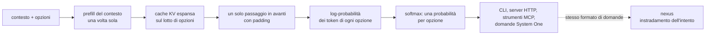

# jev-pakkio

[Tutti i progetti](../README.md) · [jev-pakkio](README.md) · [architettura](ARCHITECTURE.md) · [flussi di lavoro](WORKFLOWS.md)

**Punteggio delle opzioni in un solo passaggio** con un Gemma 3 4B locale, su Apple silicon con MLX oppure su NVIDIA/CPU con PyTorch
(`--backend torch`). Dato un contesto e un elenco di opzioni già scritte, il modello codifica il contesto una volta, espande la sua
cache KV sull'intero lotto di opzioni e punteggia ognuna in un solo passaggio in avanti con padding. Nessuna decodifica: il punteggio è
la log-probabilità dei token dell'opzione dato il contesto, e un softmax sui punteggi dà una probabilità per opzione, come
`jevlike-predict`. Repository pubblico: [github.com/pakkio/jev-pakkio](https://github.com/pakkio/jev-pakkio) (Python; ultimo
commit 2026-10-06).

Il costo di aggiungere opzioni è un solo passaggio con padding, non uno per opzione: è questo che lo rende veloce.

## Dove leggere

| Pagina | Cosa contiene |
|---|---|
| [Architettura](ARCHITECTURE.md) | Il pacchetto `jev_pakkio`: scorer, server, motori, strumenti MCP, testa addestrabile, LoRA, memoria |
| [Flussi di lavoro](WORKFLOWS.md) | Installare, servire, addestrare una testa o un LoRA, misurare, la demo Doom |

## I documenti del repository

La documentazione è in `docs/` (costruita con mkdocs): [`index`](https://github.com/pakkio/jev-pakkio/blob/HEAD/docs/index.md),
[`getting-started`](https://github.com/pakkio/jev-pakkio/blob/HEAD/docs/getting-started.md),
[`cli`](https://github.com/pakkio/jev-pakkio/blob/HEAD/docs/cli.md),
[`training`](https://github.com/pakkio/jev-pakkio/blob/HEAD/docs/training.md),
[`lora`](https://github.com/pakkio/jev-pakkio/blob/HEAD/docs/lora.md),
[`doom-demo`](https://github.com/pakkio/jev-pakkio/blob/HEAD/docs/doom-demo.md),
[`mem`](https://github.com/pakkio/jev-pakkio/blob/HEAD/docs/mem.md),
[`api`](https://github.com/pakkio/jev-pakkio/blob/HEAD/docs/api.md) e le note di progetto
[`one-pass-option-scoring`](https://github.com/pakkio/jev-pakkio/blob/HEAD/docs/design/one-pass-option-scoring.md) e
[`per-task-finetuning-with-gemma`](https://github.com/pakkio/jev-pakkio/blob/HEAD/docs/design/per-task-finetuning-with-gemma.md).
