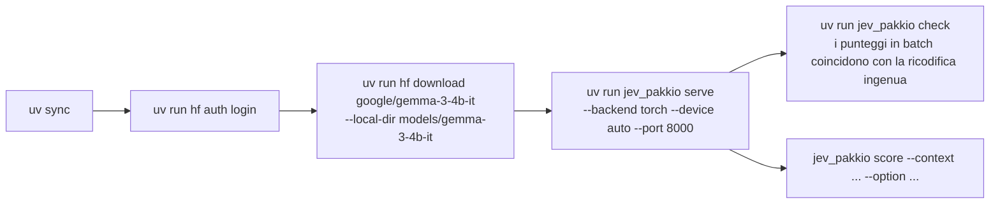
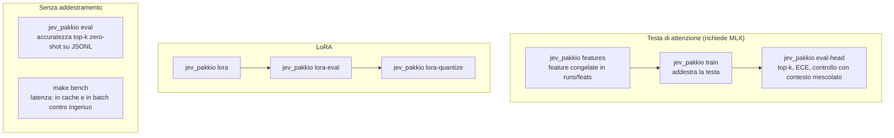
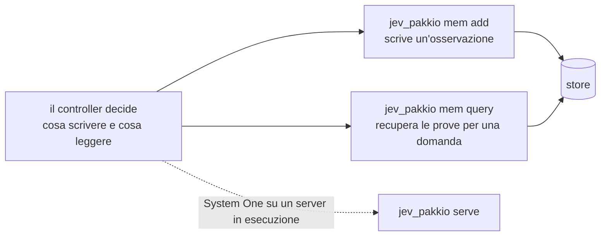

# jev-pakkio: flussi di lavoro

[Tutti i progetti](../README.md) · [jev-pakkio](README.md) · [architettura](ARCHITECTURE.md) · [flussi di lavoro](WORKFLOWS.md)

## Installare e servire

Serve Python 3.12+ e `uv`; la licenza di Gemma va accettata su Hugging Face prima del download. Su macOS (`make setup`) il comando
sceglie MLX; altrove PyTorch. Per NVIDIA si installa prima la build di PyTorch adatta e poi si usa `uv run --no-sync` perché `uv`
non la sostituisca.

## Usare il server

Con il server acceso (`make serve`):

| Cosa | Come |
|---|---|
| Stato | `make health` → `GET /health` |
| Punteggio di opzioni | `POST /score` con contesto e opzioni (`make request` ne mostra un esempio) |
| Domande System One | `POST /v1/systemone`: scelta, punteggio e sì/no insieme (`make systemone`) |
| Demo Doom | `make doom` (richiede il server acceso): il modello sceglie ogni azione |
| Da un agente | `jev_pakkio mcp` espone `classify`, `rate`, `noul`, `jev`, `train_lora`, `status` |

## Addestrare e misurare

I dati sintetici si generano con gli script `gen_*.py`; `compare_jev.py` mette `jev_pakkio` accanto al Jev ospitato di TypeSafe sulle
stesse righe, e `bench_mixed.py` fa girare 100 domande miste (40 di scelta, 30 sì/no, 30 di punteggio) su tutti i motori.

## Memoria agentica (Jev-Mem)

