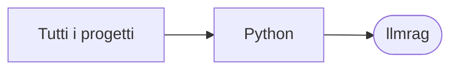

# llmrag

[Tutti i progetti](../README.md)

> Voce di catalogo generata dai metadati di GitHub con `build_projects.py` (`just projects`). Non si modifica a mano.

| | |
|---|---|
| Repository | [pakkio/llmrag](https://github.com/pakkio/llmrag) |
| Linguaggio | Python |
| Tipo | originale |
| Creato | 2025-06-09 |
| Ultimo push | 2025-06-21 |
| Dimensione | 103646 KB |

## Dal suo README

> LLM RAG System A comprehensive Retrieval-Augmented Generation (RAG) system that processes PDF documents and provides advanced search capabilities through hybrid semantic-keyword search, intelligent LLM reranking, adaptive query enhancement, and real-time confidence scoring. Features 🔍 Advanced Search System

## Dove si colloca

