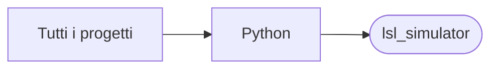

# lsl_simulator

[Tutti i progetti](../README.md)

> Voce di catalogo generata dai metadati di GitHub con `build_projects.py` (`just projects`). Non si modifica a mano.

| | |
|---|---|
| Repository | [pakkio/lsl_simulator](https://github.com/pakkio/lsl_simulator) |
| Linguaggio | Python |
| Tipo | originale |
| Creato | 2025-07-05 |
| Ultimo push | 2025-07-13 |
| Dimensione | 495 KB |

## Dal suo README

> LSL Simulator A production-ready Python implementation for parsing and simulating LSL (Linden Scripting Language) scripts. Built with unified ANTLR4 architecture and comprehensive API coverage. Features Unified ANTLR4 Parser**: Single parsing system for all LSL syntax

## Dove si colloca

