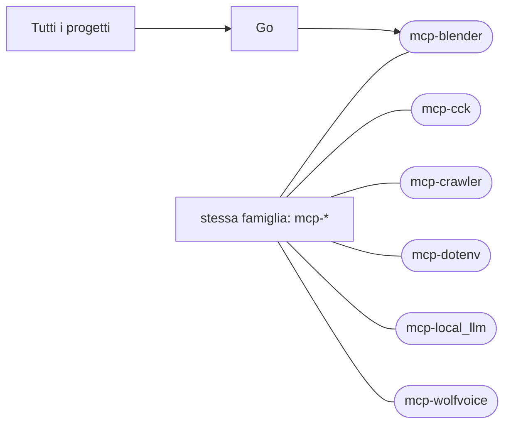

# mcp-blender

[Tutti i progetti](../README.md)

> Voce di catalogo generata dai metadati di GitHub con `build_projects.py` (`just projects`). Non si modifica a mano.

| | |
|---|---|
| Repository | [pakkio/mcp-blender](https://github.com/pakkio/mcp-blender) |
| Linguaggio | Go |
| Tipo | originale |
| Creato | 2026-08-14 |
| Ultimo push | 2026-09-23 |
| Licenza | MIT |
| Dimensione | 2893 KB |

## Dal suo README

> mcp-blender (v2.3.5) Exposes Blender to MCP clients (Claude Code, Claude Desktop, Antigravity, and others) through a high-performance two-process bridge, mirroring mcp-unity's architecture but built in pure Python for Blender's native runtime:

## Dove si colloca

Stessa famiglia (prefisso del nome in comune): [mcp-cck](../mcp-cck/README.md), [mcp-crawler](../mcp-crawler/README.md), [mcp-dotenv](../mcp-dotenv/README.md), [mcp-local_llm](../mcp-local_llm/README.md), [mcp-wolfvoice](../mcp-wolfvoice/README.md)
