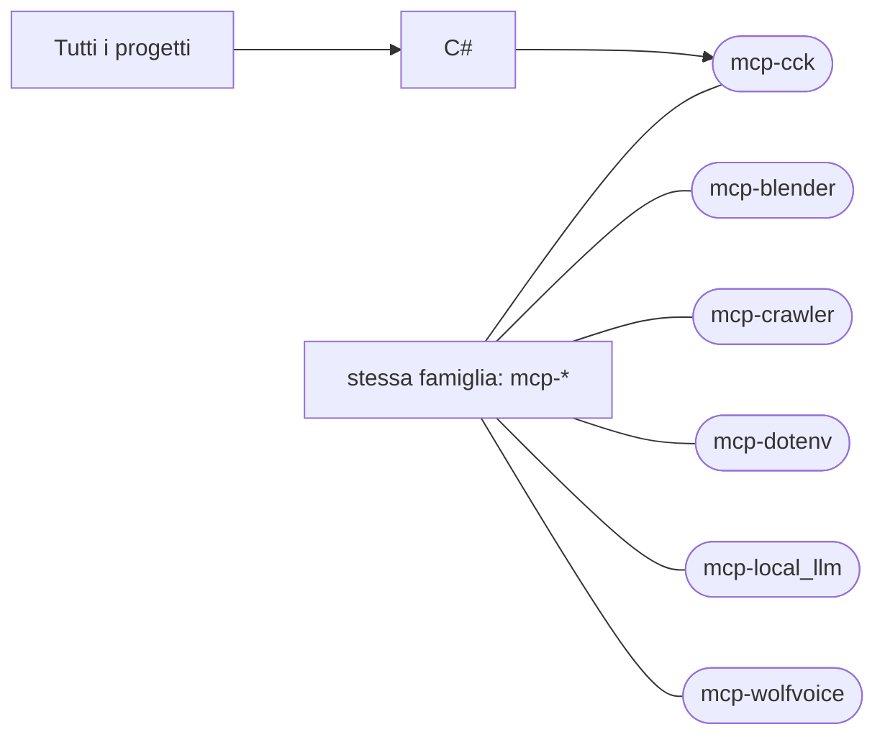

# mcp-cck

[Tutti i progetti](../README.md)

> Voce di catalogo generata dai metadati di GitHub con `build_projects.py` (`just projects`). Non si modifica a mano.

| | |
|---|---|
| Repository | [pakkio/mcp-cck](https://github.com/pakkio/mcp-cck) |
| Linguaggio | C# |
| Tipo | originale |
| Creato | 2026-08-11 |
| Ultimo push | 2026-09-13 |
| Licenza | MIT |
| Dimensione | 10680 KB |

## Dal suo README

> MCP Unity Editor (Game Engine) MCP Unity is an implementation of the Model Context Protocol for Unity Editor, allowing AI assistants to interact with your Unity projects. This package provides a bridge between Unity and a Node.js server that implements the MCP protocol, enabling AI agents like Cursor, Windsurf, Claude Code, Codex CLI, GitHub Copilot, Google Antigravity, and OpenCode to execute operations within the…

## Dove si colloca

Stessa famiglia (prefisso del nome in comune): [mcp-blender](../mcp-blender/README.md), [mcp-crawler](../mcp-crawler/README.md), [mcp-dotenv](../mcp-dotenv/README.md), [mcp-local_llm](../mcp-local_llm/README.md), [mcp-wolfvoice](../mcp-wolfvoice/README.md)
