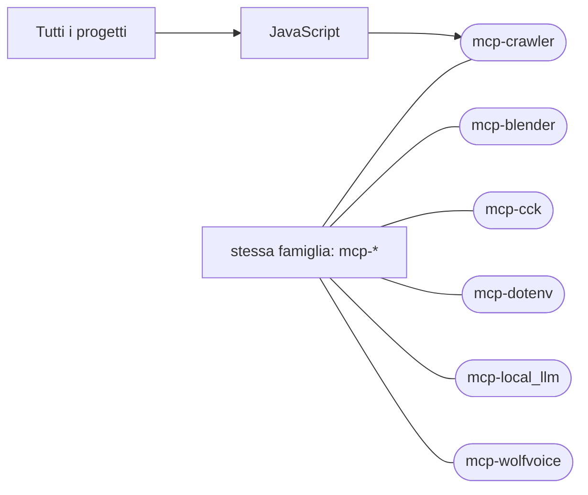

# mcp-crawler

[Tutti i progetti](../README.md)

> Voce di catalogo generata dai metadati di GitHub con `build_projects.py` (`just projects`). Non si modifica a mano.

| | |
|---|---|
| Repository | [pakkio/mcp-crawler](https://github.com/pakkio/mcp-crawler) |
| Linguaggio | JavaScript |
| Tipo | originale |
| Creato | 2026-08-02 |
| Ultimo push | 2026-10-18 |
| Dimensione | 51 KB |

crawler

## Dal suo README

> mcp-crawler MCP server that crawls a URL, indexes the text in SQLite FTS5 and searches it with regex or plain-text matching (no AI involved in retrieval). Tools crawl_url`, `search_text`, `search_regex`, `list_indexed_pages`, `crawler_stats`, `clear_index`.

## Dove si colloca

Stessa famiglia (prefisso del nome in comune): [mcp-blender](../mcp-blender/README.md), [mcp-cck](../mcp-cck/README.md), [mcp-dotenv](../mcp-dotenv/README.md), [mcp-local_llm](../mcp-local_llm/README.md), [mcp-wolfvoice](../mcp-wolfvoice/README.md)
