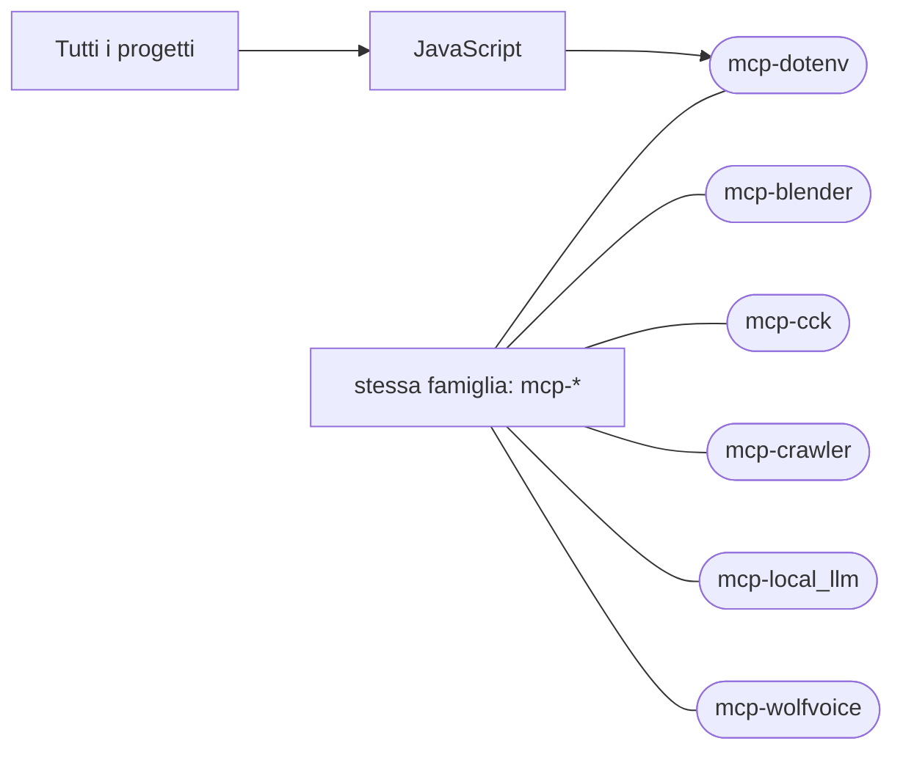

# mcp-dotenv

[Tutti i progetti](../README.md)

> Voce di catalogo generata dai metadati di GitHub con `build_projects.py` (`just projects`). Non si modifica a mano.

| | |
|---|---|
| Repository | [pakkio/mcp-dotenv](https://github.com/pakkio/mcp-dotenv) |
| Linguaggio | JavaScript |
| Tipo | originale |
| Creato | 2026-08-02 |
| Ultimo push | 2026-10-18 |
| Dimensione | 18 KB |

## Dal suo README

> mcp-dotenv MCP server to read and manage `.env` files and scan code for secrets **without exposing the values**: the model sees masked output (`ab****yz (len=32)`). Tools list_env_keys`, `check_env_exists`, `get_env_masked`, `describe_env_value`, `set_env_value`, `delete_env_key`, `scan_file`, `scan_directory`, `redact_file`.

## Dove si colloca

Stessa famiglia (prefisso del nome in comune): [mcp-blender](../mcp-blender/README.md), [mcp-cck](../mcp-cck/README.md), [mcp-crawler](../mcp-crawler/README.md), [mcp-local_llm](../mcp-local_llm/README.md), [mcp-wolfvoice](../mcp-wolfvoice/README.md)
