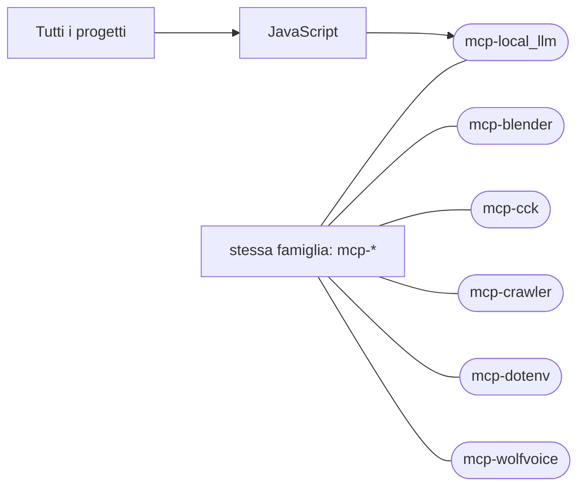

# mcp-local_llm

[Tutti i progetti](../README.md)

> Voce di catalogo generata dai metadati di GitHub con `build_projects.py` (`just projects`). Non si modifica a mano.

| | |
|---|---|
| Repository | [pakkio/mcp-local_llm](https://github.com/pakkio/mcp-local_llm) |
| Linguaggio | JavaScript |
| Tipo | originale |
| Creato | 2026-08-01 |
| Ultimo push | 2026-08-02 |
| Dimensione | 34 KB |

## Dal suo README

> local-llm MCP server that lets Claude Code delegate trivial, standalone questions to a local Gemma 4 model (via llama.cpp), so they don't burn paid tokens. Architecture Each `ask_local_llm` call spawns `llama-cli` directly (one process per request, via Node's `execFile`) and parses its stdout. There is **no persistent server and no HTTP hop** — earlier versions ran `llama-server` and talked to it over…

## Dove si colloca

Stessa famiglia (prefisso del nome in comune): [mcp-blender](../mcp-blender/README.md), [mcp-cck](../mcp-cck/README.md), [mcp-crawler](../mcp-crawler/README.md), [mcp-dotenv](../mcp-dotenv/README.md), [mcp-wolfvoice](../mcp-wolfvoice/README.md)
