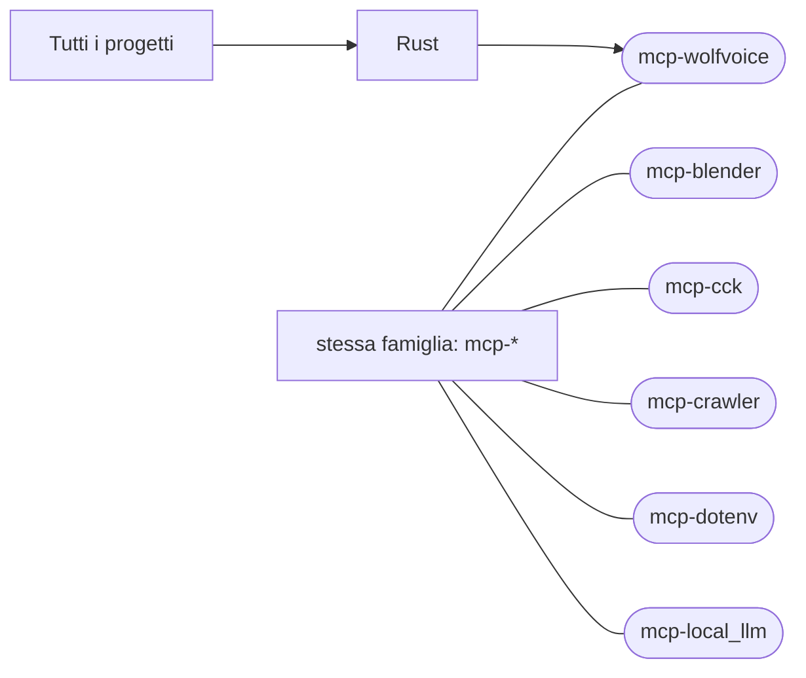

# mcp-wolfvoice

[Tutti i progetti](../README.md)

> Voce di catalogo generata dai metadati di GitHub con `build_projects.py` (`just projects`). Non si modifica a mano.

| | |
|---|---|
| Repository | [pakkio/mcp-wolfvoice](https://github.com/pakkio/mcp-wolfvoice) |
| Linguaggio | Rust |
| Tipo | originale |
| Creato | 2026-09-18 |
| Ultimo push | 2026-10-11 |
| Licenza | Apache-2.0 |
| Dimensione | 172 KB |

## Dal suo README

> wolfvoice Spatial WebRTC voice for OpenSimulator — one service that Firestorm and browser-based viewers both reach through the region's own capabilities, so users of different viewers hear each other, positionally.

## Dove si colloca

Stessa famiglia (prefisso del nome in comune): [mcp-blender](../mcp-blender/README.md), [mcp-cck](../mcp-cck/README.md), [mcp-crawler](../mcp-crawler/README.md), [mcp-dotenv](../mcp-dotenv/README.md), [mcp-local_llm](../mcp-local_llm/README.md)
