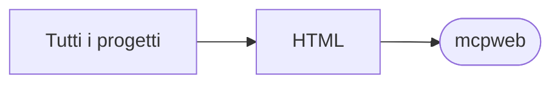

# mcpweb

[Tutti i progetti](../README.md)

> Voce di catalogo generata dai metadati di GitHub con `build_projects.py` (`just projects`). Non si modifica a mano.

| | |
|---|---|
| Repository | [pakkio/mcpweb](https://github.com/pakkio/mcpweb) |
| Linguaggio | HTML |
| Tipo | originale |
| Creato | 2026-02-27 |
| Ultimo push | 2026-02-27 |
| Dimensione | 10 KB |

## Dal suo README

> mcpweb

## Dove si colloca

