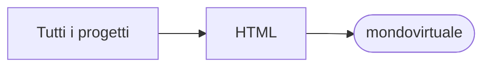

# mondovirtuale

[Tutti i progetti](../README.md)

> Voce di catalogo generata dai metadati di GitHub con `build_projects.py` (`just projects`). Non si modifica a mano.

| | |
|---|---|
| Repository | [pakkio/mondovirtuale](https://github.com/pakkio/mondovirtuale) |
| Linguaggio | HTML |
| Tipo | originale |
| Creato | 2025-09-23 |
| Ultimo push | 2025-09-23 |
| Dimensione | 3 KB |

## Dal suo README

> Mondo Virtuale Simple virtual world with procedural generation, WebSocket server-client architecture, and WASD movement. Setup 1. Install dependencies:

## Dove si colloca

