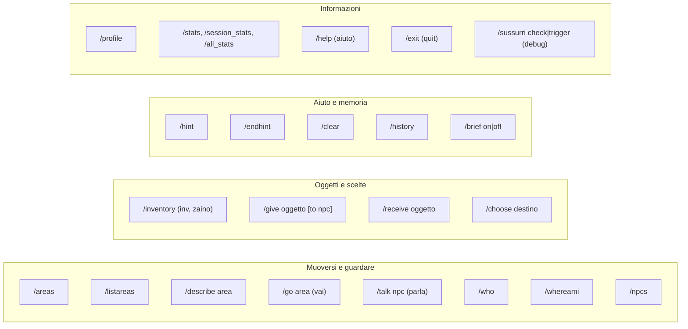
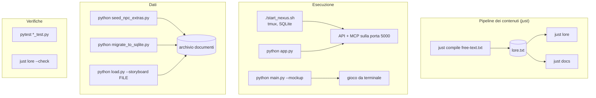

# Comandi

[Tutti i progetti](../README.md) · [Nexus](README.md) · Motore: [panoramica](ENGINE.md), [flusso delle richieste](ENGINE-REQUEST-FLOW.md), [comandi](ENGINE-COMMANDS.md), [prompt](ENGINE-PROMPT.md), [meccaniche](ENGINE-MECHANICS.md), [storage e configurazione](ENGINE-STORAGE-CONFIG.md) · Pipeline: [panoramica](PIPELINE.md), [digest](PIPELINE-DIGEST.md), [derivazione](PIPELINE-DERIVE.md) · Lore: [il Velo](VEIL.md), [mondo](VEIL-WORLD.md), [luoghi](VEIL-PLACES.md), [NPC](VEIL-NPCS.md), [fazioni](VEIL-FACTIONS.md), [missioni](VEIL-MISSIONS.md)

Due tipi di comandi: quelli che un **giocatore** digita nel gioco e quelli che uno **sviluppatore** lancia sul progetto.

## Comandi di gioco

Gestiti da `command_processor.py`, un modulo per comando in `command_handlers/`. Il testo libero viene trasformato in questi dal
controllo dell'intento descritto nel [flusso delle richieste](ENGINE-REQUEST-FLOW.md#come-si-classifica-un-messaggio).

| Comando | Cosa fa |
|---|---|
| `/areas`, `/listareas` | Elenca le aree con i livelli di accesso (`/listareas`: su una riga, comoda da incollare) |
| `/describe <area>` | Descrizione ricca di un luogo: NPC, oggetti, lore ([luoghi](VEIL-PLACES.md)) |
| `/go <area>` (`/vai`) | Ti sposta in un'altra area; può aprire una conversazione con un NPC di lì |
| `/talk <npc>` (`/parla`) | Inizia una conversazione; costruisce il [prompt](ENGINE-PROMPT.md) dell'NPC e carica la cronologia |
| `/who`, `/whereami`, `/npcs` | Chi c'è qui, dove sei, tutti gli NPC noti nelle varie aree |
| `/inventory` (`/inv`, `/inventario`, `/zaino`) | Oggetti e crediti |
| `/give <oggetto> [to <npc>]` | Consegna un oggetto all'NPC ([regole degli scambi](ENGINE-MECHANICS.md#scambi)) |
| `/receive <oggetto>` | Chiede un oggetto all'NPC; gli arriva come "Dammi …" |
| `/choose <preserve\|dissolve\|transform>` | La decisione irreversibile sul Velo, solo dopo la comparsa dell'NPC finale ([fazioni](VEIL-FACTIONS.md)) |
| `/hint`, `/endhint` | Consulta la guida saggia, ed esce da quella consultazione |
| `/clear` | Cancella la memoria della conversazione con l'NPC corrente, solo per questa sessione |
| `/history`, `/profile` | Cronologia della conversazione; profilo psicologico del giocatore |
| `/brief [on\|off]` | Gli NPC rispondono in modo conciso, senza fronzoli narrativi |
| `/stats`, `/session_stats`, `/all_stats` | Statistiche su token e tempi |
| `/sussurri [check\|trigger]` | Debug: mostra o fa scattare gli effetti del decadimento dei Sussurri |
| `/help` (`/aiuto`), `/exit` (`/quit`) | Aiuto; esce dal gioco |

## Comandi per sviluppatori

| Comando | Cosa fa |
|---|---|
| `just compile free-text.txt` | Un LLM distilla il testo libero in `lore.txt` ([stadio 1](PIPELINE-DIGEST.md)); richiede `OPENROUTER_API_KEY`; opzioni `--model`, `--title`, `--out`, `--retries` |
| `just lore` | `lore.txt` → `ANTEFATTO.txt`, `NPC_PREFIX.*.txt` e record NPC, con backup dei record prima ([stadio 2](PIPELINE-DERIVE.md)); `--no-npcs` per saltare i record, `--check` per verificare che sia aggiornato |
| `just docs` | Rigenera le [pagine del lore](VEIL-WORLD.md) da `lore.txt` |
| `just projects` | Rigenera il catalogo dei progetti GitHub ([tutti i progetti](../README.md)) |
| `./start_nexus.sh` | (Ri)avvia API + MCP nella sessione tmux `nexus` sull'archivio SQLite |
| `python app.py` | Esegue l'API in primo piano (porta da `NEXUS_PORT`, predefinita 5000) |
| `python main.py [--mockup]` | Gioca da terminale; `--help` elenca le opzioni |
| `python seed_npc_extras.py` | Carica biglietti da visita, testi delle notecard e teletrasporti nell'archivio |
| `python migrate_to_sqlite.py` | Copia un archivio JSON in un file SQLite e verifica la copia |
| `python load.py --storyboard FILE (--mockup\|--db)` | Carica i dati della storia da schede di testo |
| `pytest *_test.py` | La suite di test (un semplice `pytest` fallisce: i `test_*.py` in radice sono script manuali) |

Configurazione e variabili d'ambiente: [storage e configurazione](ENGINE-STORAGE-CONFIG.md).
