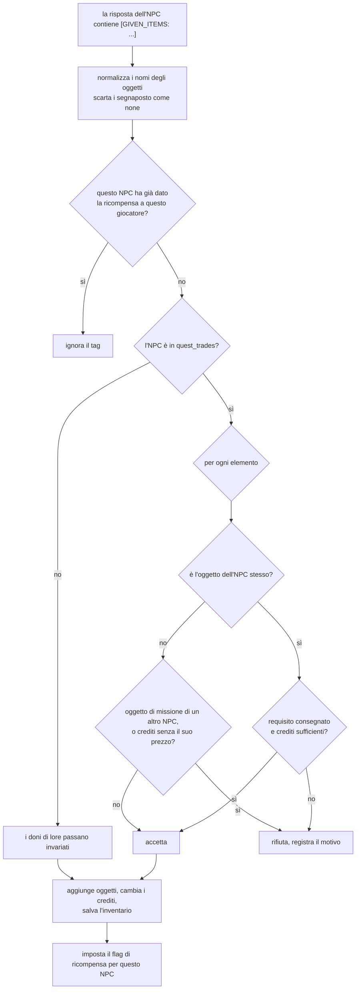
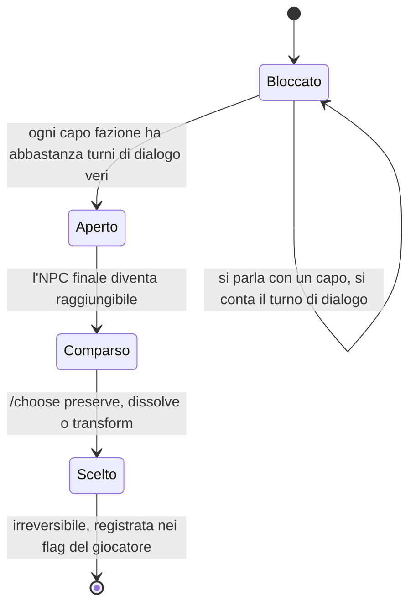
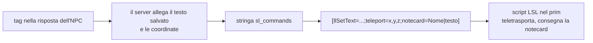

# Meccaniche di gioco

[Tutti i progetti](../README.md) · [Nexus](README.md) · Motore: [panoramica](ENGINE.md), [flusso delle richieste](ENGINE-REQUEST-FLOW.md), [comandi](ENGINE-COMMANDS.md), [prompt](ENGINE-PROMPT.md), [meccaniche](ENGINE-MECHANICS.md), [storage e configurazione](ENGINE-STORAGE-CONFIG.md) · Pipeline: [panoramica](PIPELINE.md), [digest](PIPELINE-DIGEST.md), [derivazione](PIPELINE-DERIVE.md) · Lore: [il Velo](VEIL.md), [mondo](VEIL-WORLD.md), [luoghi](VEIL-PLACES.md), [NPC](VEIL-NPCS.md), [fazioni](VEIL-FACTIONS.md), [missioni](VEIL-MISSIONS.md)

Le regole che il **server** fa rispettare sopra a ciò che dice il modello. La finzione che c'è dietro sta nel lore:
[la catena di missioni](VEIL-MISSIONS.md) e [fazioni e finale](VEIL-FACTIONS.md).

## Tag: come un NPC agisce sul mondo

Un NPC non può cambiare nulla parlando. Può solo aggiungere un tag in fondo alla risposta; `game_system_api.py` lo toglie dal testo,
lo controlla e lo applica.

| Tag | Effetto | Controllato da |
|---|---|---|
| `[GIVEN_ITEMS: oggetto, N Credits]` | Consegna oggetti o crediti al giocatore | `quest_trades.validate_grant` |
| `[OFFER_TELEPORT]` | Teletrasporta il giocatore dall'NPC che parla | servono le coordinate `teleport` dell'NPC |
| `[TELEPORT_TO:Nome]` | Teletrasporta il giocatore da un altro NPC | il bersaglio deve avere le coordinate |
| `[GIVE_NOTECARD]` | Allega il testo della notecard dell'NPC | l'NPC deve avere `notecard_feature` |
| `[GIVE_CARD]` | Allega il biglietto da visita dell'NPC | l'NPC deve avere `business_card` |

Un `[teleport=x,y,z]` scritto dal modello viene eliminato: le coordinate vengono sempre dal record dell'NPC. (La vecchia forma
`[notecard=Nome|testo]` è ancora accettata se un modello la scrive, ma i prompt degli NPC chiedono ora `[GIVE_NOTECARD]`, che allega
il testo salvato.)

## Scambi

- **La catena** (`quest_trades.py`): ogni NPC vende un oggetto in cambio di crediti o dell'oggetto di un altro NPC. La tabella è
  rispecchiata in `lore.txt` [08]; è la copia del server a decidere davvero.
- **Consegna di un oggetto richiesto**: quando il giocatore dà all'NPC ciò che chiede (`/give`), il server inserisce da sé il tag
  della ricompensa, "senza affidarsi alla correttezza del modello".
- I **crediti** possono comparire solo insieme all'oggetto dell'NPC stesso e pari al suo prezzo.

### Il donatore

Un NPC con un tesoro, senza oggetto richiesto e **non** nella tabella delle missioni dà quel tesoro quando il giocatore accetta con
chiarezza. Le parole di accettazione si riconoscono come parole intere (`accetto`, `ok`, `sì`, `d'accordo`, `procedi`,
`perfetto`, `yes`, e "lo/la/li/le prendo"); un messaggio che è un'azione tra `*asterischi*` non conta mai, e niente viene dato due volte.

## La scelta finale

Contano solo i dialoghi veri: scambiare oggetti o usare comandi con un capo non vale. Il numero di turni per capo è
`FACTION_GATE_TURNS` (predefinito 3). Finché è bloccato, `/api/chat` verso l'NPC finale restituisce 403. Dopo la scelta, all'NPC
viene detto che è definitiva e non la riapre. Codice: `veil_finale.py`. Il lato narrativo: [fazioni e finale](VEIL-FACTIONS.md).

## Notecard, biglietti da visita e teletrasporti

- Una risposta può portare **un teletrasporto e una notecard insieme**; è ammessa **una sola notecard per risposta**, il cui testo
  viene tagliato a 1500 caratteri. I testi di notecard e biglietti devono essere in ASCII semplice.
- `[OFFER_TELEPORT]` usa le coordinate dell'NPC che parla, `[TELEPORT_TO:Nome]` quelle dell'NPC indicato. Come ripiego, frasi come
  "ti porto" o "andiamo al" nella risposta contano anch'esse come offerta di teletrasporto.
- I testi stanno in `NPC_EXTRAS.json` e `NPC_BUSINESS_CARDS.json` e si caricano con `seed_npc_extras.py`.

## Conversazioni e giocatore

- **Saluti**: `/sense` mostra il saluto predefinito alla prima visita o uno dei saluti di ritorno dopo, e lo salva nella cronologia
  perché l'NPC non saluti due volte.
- **Primo incontro**: una conversazione senza cronologia salvata riceve una nota che dice che il giocatore non ha mai parlato con
  quell'NPC, così un semplice "ciao" non riceve in risposta "sei tornato".
- **Uscire** salva la conversazione con un marcatore di interruzione; al ritorno si aggiunge un marcatore "è passato del tempo".
- **Profilo**: dopo ogni scambio il profilo del giocatore (tratti, moventi, schemi decisionali) si aggiorna in un thread in
  background e rientra nel prompt dell'NPC ([assemblaggio del prompt](ENGINE-PROMPT.md)).
