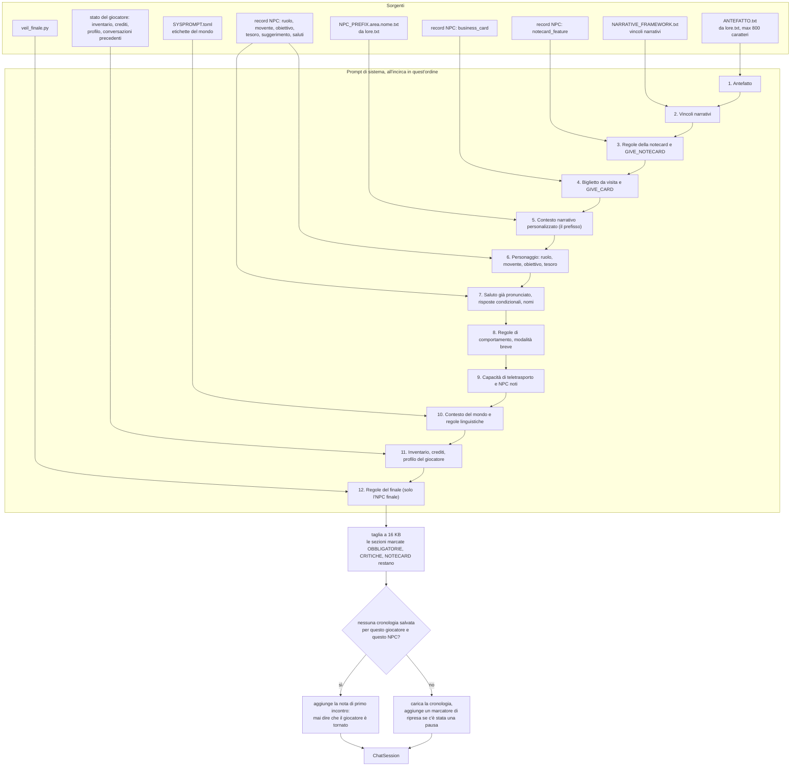
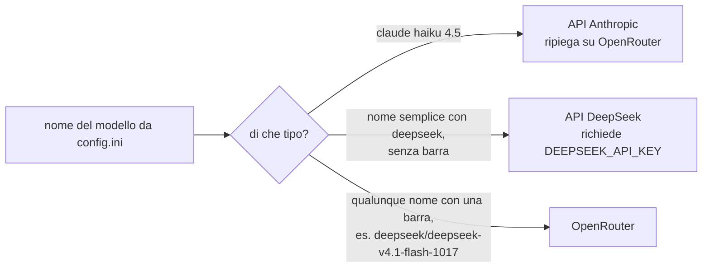

# Assemblaggio del prompt

[Tutti i progetti](../README.md) · [Nexus](README.md) · Motore: [panoramica](ENGINE.md), [flusso delle richieste](ENGINE-REQUEST-FLOW.md), [comandi](ENGINE-COMMANDS.md), [prompt](ENGINE-PROMPT.md), [meccaniche](ENGINE-MECHANICS.md), [storage e configurazione](ENGINE-STORAGE-CONFIG.md) · Pipeline: [panoramica](PIPELINE.md), [digest](PIPELINE-DIGEST.md), [derivazione](PIPELINE-DERIVE.md) · Lore: [il Velo](VEIL.md), [mondo](VEIL-WORLD.md), [luoghi](VEIL-PLACES.md), [NPC](VEIL-NPCS.md), [fazioni](VEIL-FACTIONS.md), [missioni](VEIL-MISSIONS.md)

Come si costruisce il **prompt di sistema** di un NPC quando inizia una conversazione (`/talk`, oppure `/sense` da LSL). È il punto
in cui il [lore](VEIL-WORLD.md) arriva ai personaggi: qui si leggono i file prodotti dalla [pipeline](PIPELINE.md).
Codice: `session_utils.build_system_prompt` e `load_and_prepare_conversation`.

## Cosa viene dal lore

| Parte del prompt | File | Prodotto da | Pagina del lore |
|---|---|---|---|
| Antefatto (il mondo in 800 caratteri) | `ANTEFATTO.txt` | la riga `Antefatto:` di `lore.txt` [01] | [Mondo](VEIL-WORLD.md) |
| Contesto narrativo personalizzato | `NPC_PREFIX.<area>.<nome>.txt` | `lore.txt` [05] [06] [07] [08] [09] | [NPC](VEIL-NPCS.md), [luoghi](VEIL-PLACES.md), [missioni](VEIL-MISSIONS.md) |
| Ruolo, movente, obiettivo, tesoro, suggerimento | record NPC nell'archivio | `lore.txt` [07], scritto da `just lore` | [NPC](VEIL-NPCS.md) |
| Biglietto da visita e notecard | `NPC_BUSINESS_CARDS.json`, `NPC_EXTRAS.json` | contenuto scritto a mano, caricato da `seed_npc_extras.py` | [NPC](VEIL-NPCS.md) |

Cosa contiene un file di prefisso: ruolo e luogo dell'NPC, movente e obiettivo, ciò che custodisce, come trattare il giocatore, il
posto nella catena di missioni (chi viene prima e dopo), la fazione e il prezzo di quella via, ciò che non si può conciliare, e
ciò che un NPC può o non può sapere.

## Parti che ancora non vengono dal lore

`NARRATIVE_FRAMEWORK.txt` e `SYSPROMPT.toml` descrivono ancora un vecchio mondo "Cyberspazio" e non sono generati da `lore.txt`.
È la probabile origine di parole come "algoritmo" o "server" che compaiono nel parlato degli NPC; il lore le vieta
([termini](VEIL-WORLD.md#termini)). Vedi le lacune note nella [panoramica della pipeline](PIPELINE.md#lacune-note).

## Instradamento verso il modello

