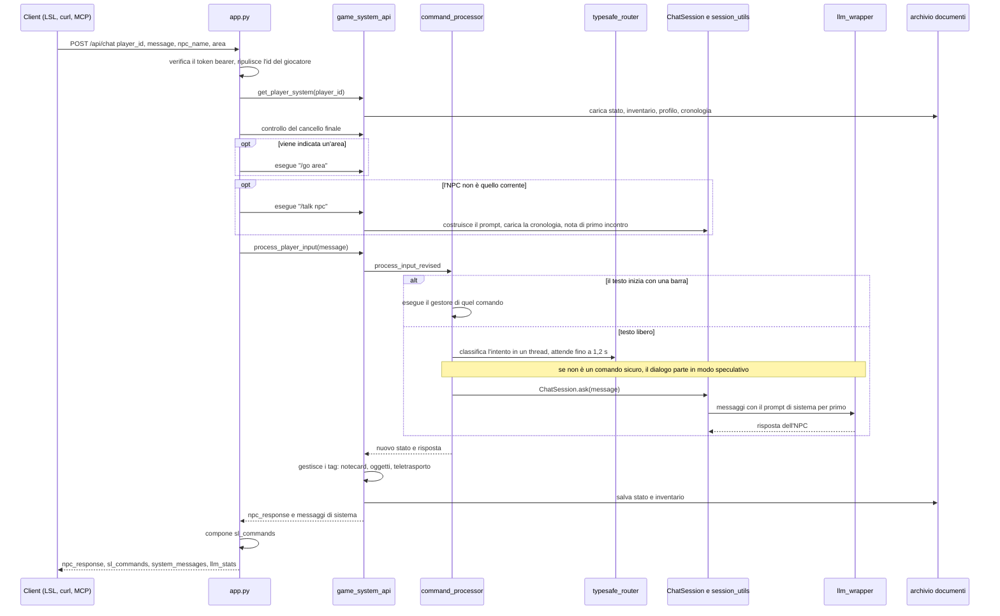
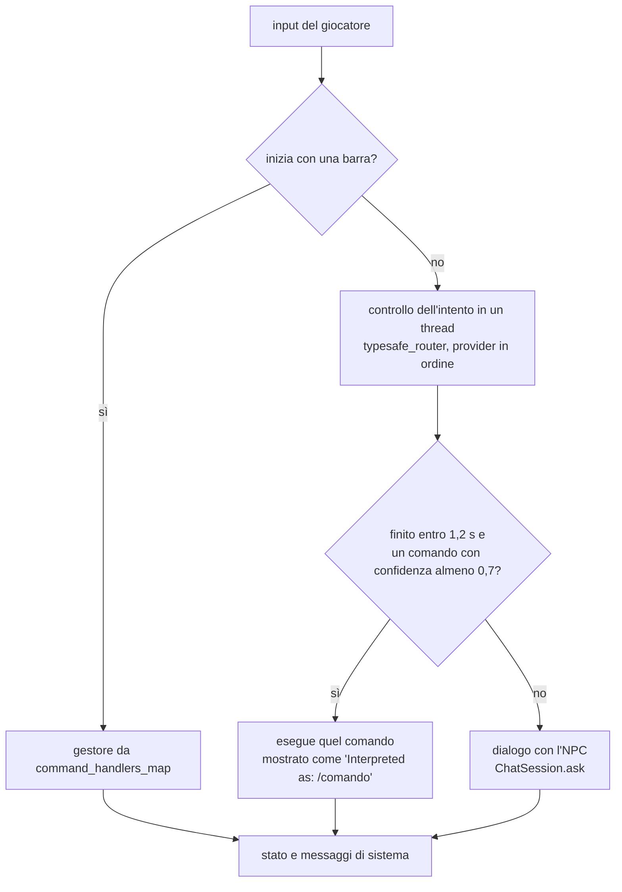
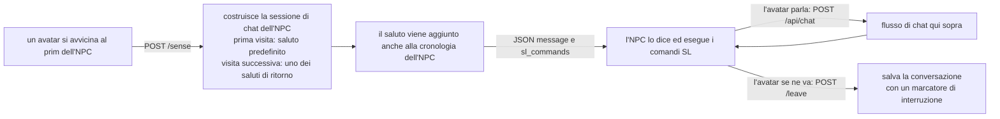

# Flusso delle richieste

[Tutti i progetti](../README.md) · [Nexus](README.md) · Motore: [panoramica](ENGINE.md), [flusso delle richieste](ENGINE-REQUEST-FLOW.md), [comandi](ENGINE-COMMANDS.md), [prompt](ENGINE-PROMPT.md), [meccaniche](ENGINE-MECHANICS.md), [storage e configurazione](ENGINE-STORAGE-CONFIG.md) · Pipeline: [panoramica](PIPELINE.md), [digest](PIPELINE-DIGEST.md), [derivazione](PIPELINE-DERIVE.md) · Lore: [il Velo](VEIL.md), [mondo](VEIL-WORLD.md), [luoghi](VEIL-PLACES.md), [NPC](VEIL-NPCS.md), [fazioni](VEIL-FACTIONS.md), [missioni](VEIL-MISSIONS.md)

Cosa succede quando un client invia `POST /api/chat`, poi come viene classificato l'input, e i due hook LSL `/sense` e `/leave`.
I componenti sono descritti nella [panoramica del motore](ENGINE.md).

## Un messaggio di chat

Note:

- Una richiesta verso un luogo o un NPC bloccato (l'NPC finale prima dell'apertura del cancello) restituisce **403** con `locked: true`.
- Il profilo del giocatore si aggiorna in un thread in background dopo la risposta, quindi non ritarda mai la risposta.
- Ogni rotta tranne `/`, `/web`, `/game` e `/version` richiede `Authorization: Bearer <NEXUS_AUTH_TOKEN>`.

## Come si classifica un messaggio

I provider di intento vengono provati nell'ordine `pplx`, `jev`, `mercury` (`TYPESAFE_PROVIDER_ORDER`); un provider che continua a
fallire viene saltato per un po' (interruttore di circuito). Un testo libero come "dammi l'infuso" diventa `/receive`; "ti do una
radice" diventa `/give`.

## Gli hook LSL

Il saluto viene salvato nella cronologia perché il modello non saluti una seconda volta; `/leave` e `/api/leave_npc` salvano la
conversazione, e alla visita successiva la riprendono con un marcatore "è passato del tempo".

## Dove vive ogni passo

| Passo | File |
|---|---|
| Autenticazione, pulizia degli id, composizione di `sl_commands` | `app.py` |
| Esecuzione del turno, gestione dei tag, aggiornamento di oggetti e crediti | `game_system_api.py` |
| Barra o testo libero, thread speculativi | `command_processor.py` |
| Provider di intento | `command_interpreter.py`, `typesafe_router.py` |
| Prompt, cronologia | `session_utils.py`, `chat_manager.py` |
| Chiamata al modello | `llm_wrapper.py` |
