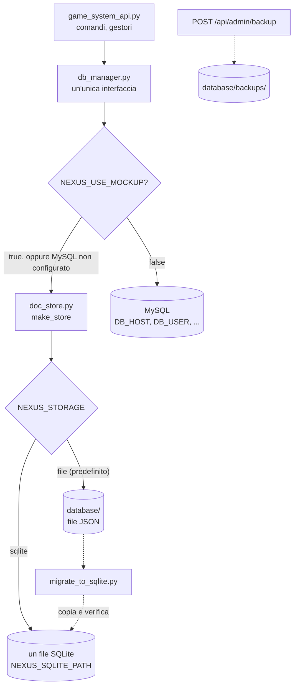
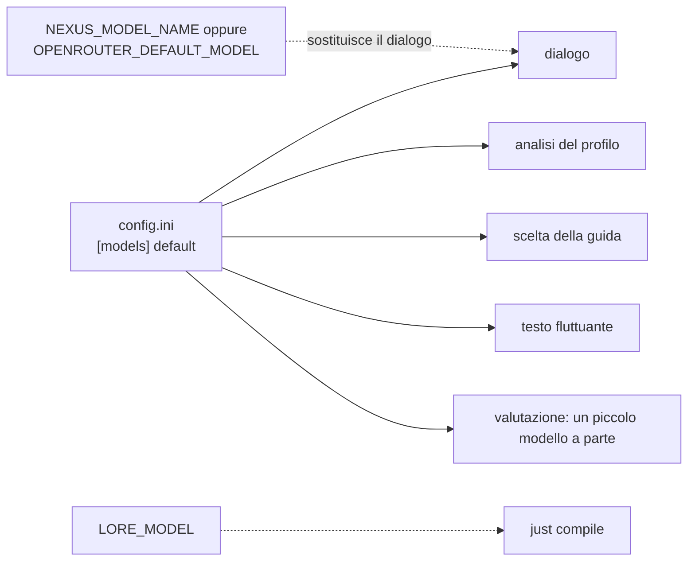
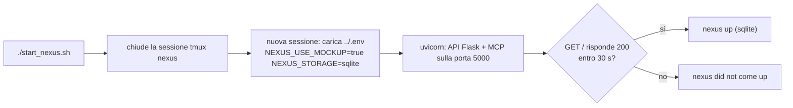

# Storage e configurazione

[Tutti i progetti](../README.md) · [Nexus](README.md) · Motore: [panoramica](ENGINE.md), [flusso delle richieste](ENGINE-REQUEST-FLOW.md), [comandi](ENGINE-COMMANDS.md), [prompt](ENGINE-PROMPT.md), [meccaniche](ENGINE-MECHANICS.md), [storage e configurazione](ENGINE-STORAGE-CONFIG.md) · Pipeline: [panoramica](PIPELINE.md), [digest](PIPELINE-DIGEST.md), [derivazione](PIPELINE-DERIVE.md) · Lore: [il Velo](VEIL.md), [mondo](VEIL-WORLD.md), [luoghi](VEIL-PLACES.md), [NPC](VEIL-NPCS.md), [fazioni](VEIL-FACTIONS.md), [missioni](VEIL-MISSIONS.md)

Dove stanno i dati, quale modello risponde e quali interruttori cambiano il comportamento. La tabella completa delle variabili
d'ambiente è nel README del repository ([`../../README.md`](../../README.md#running-and-configuring)).

## Archiviazione

I documenti sono raggruppati per **tipo**:

| Tipo | Chiave | Contiene |
|---|---|---|
| `NPCs`, `Locations`, `Storyboards` | codice NPC, nome del luogo | I contenuti: scritti da `load.py` e `just lore` |
| `PlayerState`, `PlayerProfiles` | id del giocatore | Dov'è il giocatore, i flag, il profilo psicologico |
| `Inventory` | id del giocatore | Oggetti e crediti |
| `ConversationHistory` | `giocatore/codice NPC` | La conversazione con ciascun NPC |
| `ConversationAnalysis` | id del giocatore | Testo di analisi |

`database/` non è in git. Tre cose scrivono i contenuti degli NPC: `load.py` (da schede di testo), `just lore` (dal canone) e
`seed_npc_extras.py` (biglietti, notecard, teletrasporti). `start_nexus.sh` avvia il server sul file SQLite `database/nexus.db`;
`just lore` scrive nei file JSON a meno che sia impostato `NEXUS_STORAGE=sqlite NEXUS_SQLITE_PATH=…`.

## Modelli

Una sola riga di `config.ini` cambia insieme dialogo, analisi del profilo, scelta della guida e testo fluttuante; il file conserva un
commento per ogni modello provato e scartato. `just compile` usa `LORE_MODEL`, altrimenti lo stesso predefinito.
Come il nome del modello sceglie il provider: [assemblaggio del prompt](ENGINE-PROMPT.md#instradamento-verso-il-modello).

## Interruttori che contano

| Variabile | Effetto |
|---|---|
| `OPENROUTER_API_KEY` | Obbligatoria; letta dal `.env` del repo, poi da `../.env` |
| `NEXUS_AUTH_TOKEN`, `NEXUS_ADMIN_KEY` | Token bearer e chiave admin. I valori predefiniti sono pubblici e deboli: cambiali fuori dallo sviluppo |
| `NEXUS_USE_MOCKUP`, `NEXUS_STORAGE`, `NEXUS_SQLITE_PATH` | Quale archivio |
| `FACTION_GATE_TURNS` | Turni di dialogo per capo prima che compaia l'NPC finale (predefinito 3) |
| `TYPESAFE_*`, `PPLX_MODEL`, `MERCURY_MODEL` | Provider di instradamento dell'intento ([flusso delle richieste](ENGINE-REQUEST-FLOW.md#come-si-classifica-un-messaggio)) |
| `DEBUG_SYSTEM_PROMPT`, `DEBUG_PREFIX_SEARCH`, `NEXUS_DEBUG_MODE` | Diagnostica |

## Avvio e riavvio

Dopo aver cambiato codice o contenuti letti all'avvio (`ANTEFATTO.txt` e i file di prefisso si leggono quando inizia una
conversazione; i record NPC quando si legge l'archivio), riavvia con `./start_nexus.sh`.
