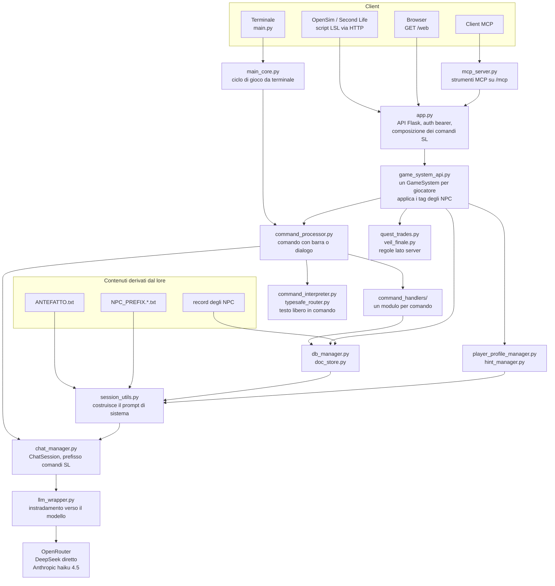

# Panoramica del motore

[Tutti i progetti](../README.md) · [Nexus](README.md) · Motore: [panoramica](ENGINE.md), [flusso delle richieste](ENGINE-REQUEST-FLOW.md), [comandi](ENGINE-COMMANDS.md), [prompt](ENGINE-PROMPT.md), [meccaniche](ENGINE-MECHANICS.md), [storage e configurazione](ENGINE-STORAGE-CONFIG.md) · Pipeline: [panoramica](PIPELINE.md), [digest](PIPELINE-DIGEST.md), [derivazione](PIPELINE-DERIVE.md) · Lore: [il Velo](VEIL.md), [mondo](VEIL-WORLD.md), [luoghi](VEIL-PLACES.md), [NPC](VEIL-NPCS.md), [fazioni](VEIL-FACTIONS.md), [missioni](VEIL-MISSIONS.md)

Come si collegano i pezzi del motore di Nexus. Per il viaggio di un singolo messaggio vedi il
[flusso delle richieste](ENGINE-REQUEST-FLOW.md); per ciò che entra nel prompt di un NPC vedi l'
[assemblaggio del prompt](ENGINE-PROMPT.md).

## Livelli

| Livello | File | Compito |
|---|---|---|
| Punti d'ingresso | `app.py`, `mcp_server.py`, `main.py` | Ricevono messaggi da LSL, browser, client MCP o terminale |
| Gioco per giocatore | `game_system_api.py`, `game_state.py` | Tengono lo stato di un giocatore; eseguono un turno; applicano i tag emessi dagli NPC |
| Smistamento | `command_processor.py`, `command_handlers/`, `command_interpreter.py`, `typesafe_router.py` | Decidono se l'input è un comando o un dialogo, e lo eseguono |
| Dialogo | `session_utils.py`, `chat_manager.py`, `llm_wrapper.py` | Costruiscono il prompt, tengono la cronologia, chiamano il modello |
| Regole | `quest_trades.py`, `veil_finale.py` | Cosa un NPC può davvero consegnare; quando compare l'NPC finale |
| Memoria | `player_profile_manager.py`, `hint_manager.py`, `consequence_system.py` | Profilo del giocatore, suggerimenti, conseguenze |
| Archiviazione | `db_manager.py`, `doc_store.py` | File JSON, SQLite o MySQL dietro un'unica interfaccia |
| Contenuti | `ANTEFATTO.txt`, `NPC_PREFIX.*.txt`, record NPC, `NPC_EXTRAS.json`, `NPC_BUSINESS_CARDS.json` | Il mondo visto dagli NPC (derivato dal [lore](VEIL-WORLD.md) dalla [pipeline](PIPELINE.md)) |

## Regole di progetto che spiegano la forma

- **Il modello propone, il server decide.** La risposta di un NPC può portare tag come `[GIVEN_ITEMS: …]`;
  `game_system_api.py` li valida contro `quest_trades.py` prima che cambi qualcosa. Vedi le [meccaniche](ENGINE-MECHANICS.md).
- **Una sola implementazione per comportamento.** `mcp_server.py` avvolge soltanto le rotte REST, quindi gli strumenti MCP e l'API
  HTTP non possono divergere.
- **I contenuti sono dati.** Testi degli NPC, luoghi e riassunto del mondo vengono da file e archivi, mai dal codice; la
  [pipeline](PIPELINE.md) li rigenera da un solo canone.

Dove sta e come si configura tutto: [storage e configurazione](ENGINE-STORAGE-CONFIG.md).
