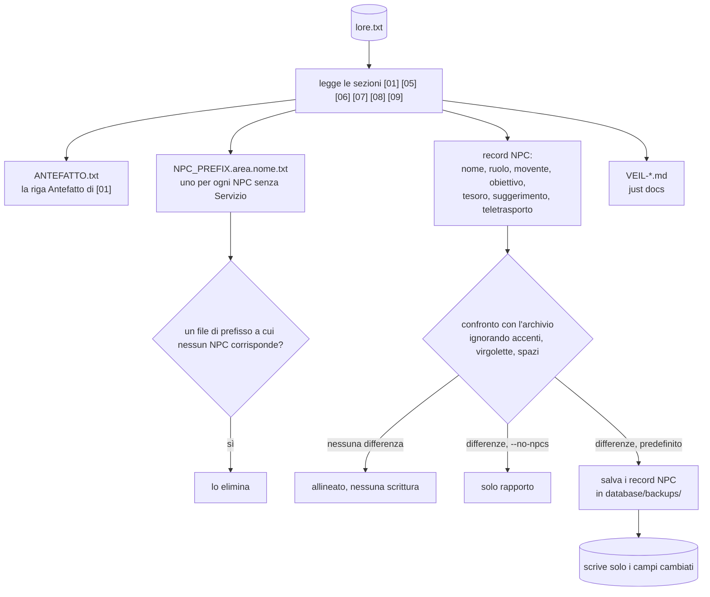
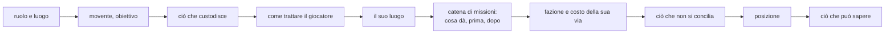

# Stadio 2: derivazione (da `lore.txt` a parti del prompt, record NPC e pagine)

[Tutti i progetti](../README.md) · [Nexus](README.md) · Motore: [panoramica](ENGINE.md), [flusso delle richieste](ENGINE-REQUEST-FLOW.md), [comandi](ENGINE-COMMANDS.md), [prompt](ENGINE-PROMPT.md), [meccaniche](ENGINE-MECHANICS.md), [storage e configurazione](ENGINE-STORAGE-CONFIG.md) · Pipeline: [panoramica](PIPELINE.md), [digest](PIPELINE-DIGEST.md), [derivazione](PIPELINE-DERIVE.md) · Lore: [il Velo](VEIL.md), [mondo](VEIL-WORLD.md), [luoghi](VEIL-PLACES.md), [NPC](VEIL-NPCS.md), [fazioni](VEIL-FACTIONS.md), [missioni](VEIL-MISSIONS.md)

`compile_lore.py` (`just lore`, anche `./compile-lore`) e `build_docs.py` (`just docs`). Nessun modello coinvolto e nulla inventato:
gli script leggono la struttura che lo [stadio 1](PIPELINE-DIGEST.md) garantisce. Panoramica: [la pipeline](PIPELINE.md).

## Di cosa è fatto un file di prefisso

Costruito dal blocco dell'NPC in [07] più parti condivise; l'ordine è fisso.

| Parte | Presa da |
|---|---|
| Ruolo, movente, obiettivo, custodisce, come trattarlo, posizione | il blocco dell'NPC in [07] |
| Il suo luogo | il blocco del luogo in [06] |
| Catena: cosa dà; chi viene prima e dopo | [08], abbinando il nome esatto dell'oggetto; un NPC la cui vendita non è collegata a nessun altro è "fuori catena" |
| Fazione e costo della sua via | `Fazione: TAG / DESTINO` in [07] con le voci corrispondenti di [05] |
| I costi di ogni via | gli NPC con `Finale: si`, da [05] |
| Ciò che non si concilia | il paragrafo `Incompatibilita` di [05], per gli NPC che nomina |
| Ciò che può sapere | le prime cinque righe di [09]; un esempio "(A contro B)" resta solo per A |

## Etichette in [07]

| Etichetta | Usata per |
|---|---|
| `Ruolo` `Movente` `Obiettivo` `Tesoro` `Trattarlo` `Posizione` | il testo del prefisso e il record NPC |
| `Fazione: TAG / DESTINO` | blocco fazione del prefisso; il grafo in [fazioni](VEIL-FACTIONS.md) |
| `Finale: si` | il prefisso elenca il costo di ogni via; il grafo del finale |
| `Servizio: si` | nessun file di prefisso (un NPC di servizio fuori dalla storia) |
| `tp x,y,z` in fondo a `Posizione` | il campo `teleport` del record |

## Le scritture nell'archivio nel dettaglio

- Campi confrontati: `name, role, motivation, goal, treasure, playerhint, teleport`. Gli altri campi (saluti, emote, animazioni,
  notecard, biglietti da visita) non si toccano mai.
- Due testi sono "uguali" se differiscono solo per accenti, virgolette, spaziatura o un punto finale. Si scrivono solo i campi che
  differiscono davvero, così un digest che ha perso un accento non peggiora mai il testo salvato.
- Un NPC assente dall'archivio viene creato. Il backup è `<root>/backups/NPCs-before-compile-lore-<ora>.json`.
- L'archivio si sceglie come per il server: `NEXUS_STORAGE` / `NEXUS_SQLITE_PATH`, `--root` per la cartella.

## Aggiornamento

`just lore --check` non scrive nulla ed esce con 1 se un file generato non è aggiornato (compreso un file di prefisso orfano); con
`--npcs` fallisce anche se i record NPC differiscono. `just docs --check` fa lo stesso per le pagine del lore.

## Le pagine del lore

`build_docs.py` genera [`VEIL-WORLD.md`](VEIL-WORLD.md), [`VEIL-PLACES.md`](VEIL-PLACES.md), [`VEIL-NPCS.md`](VEIL-NPCS.md),
[`VEIL-FACTIONS.md`](VEIL-FACTIONS.md) e [`VEIL-MISSIONS.md`](VEIL-MISSIONS.md): prosa copiata da `lore.txt` e grafi Mermaid
calcolati dalla sua struttura (chi vive dove, la catena di scambi, le fazioni e l'NPC della scelta finale). Non possono
discostarsi dal canone.
