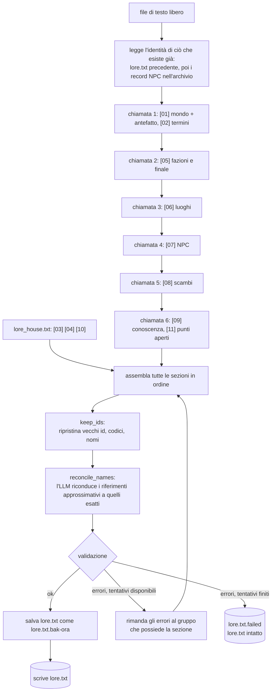

# Stadio 1: digest (dal testo libero a `lore.txt`)

[Tutti i progetti](../README.md) · [Nexus](README.md) · Motore: [panoramica](ENGINE.md), [flusso delle richieste](ENGINE-REQUEST-FLOW.md), [comandi](ENGINE-COMMANDS.md), [prompt](ENGINE-PROMPT.md), [meccaniche](ENGINE-MECHANICS.md), [storage e configurazione](ENGINE-STORAGE-CONFIG.md) · Pipeline: [panoramica](PIPELINE.md), [digest](PIPELINE-DIGEST.md), [derivazione](PIPELINE-DERIVE.md) · Lore: [il Velo](VEIL.md), [mondo](VEIL-WORLD.md), [luoghi](VEIL-PLACES.md), [NPC](VEIL-NPCS.md), [fazioni](VEIL-FACTIONS.md), [missioni](VEIL-MISSIONS.md)

`digest_lore.py`, lanciato come `just compile <file…>`. Un LLM trasforma il testo libero nelle sezioni di `lore.txt` che dipendono
dalla storia; le sezioni indipendenti dalla storia vengono incollate da `lore_house.txt`. Stadio successivo:
[derivazione](PIPELINE-DERIVE.md). Panoramica: [la pipeline](PIPELINE.md).

Ogni chiamata riceve il testo sorgente e le sezioni già scritte, così nomi, id e codici restano coerenti. Una risposta vuota o senza
intestazione viene ritentata (tre tentativi per gruppo). Le sezioni possono usare intestazioni approssimative (`[07 PERSONAGGI]`);
vengono riscritte nella forma canonica `[07 PNG]`.

## Cosa si chiede al modello

| Sezione | Contenuto che scrive il modello | Formato letto da uno script |
|---|---|---|
| [01] | Mondo, storia, la crisi, il ruolo del giocatore, i temi | Una riga `Antefatto (per i prompt, max 780 caratteri): …` |
| [02] | Termini, parole vietate, nomi sbagliati | testo libero |
| [05] | Fazioni, costi di ogni via, incompatibilità, il finale | ` - TAG, …` per le fazioni; ` - DESTINO: …` per ogni via |
| [06] | Luoghi | `id \| Nome \| accesso \| chi` poi righe rientrate |
| [07] | NPC | `NPC.<id luogo>.<ultima parola> \| Nome \| Luogo` poi righe con etichetta (`Ruolo`, `Movente`, `Obiettivo`, `Tesoro`, `Trattarlo`, `Fazione`, `Finale`, `Servizio`, `Posizione`) |
| [08] | Scambi | `Nome -> Oggetto   per N crediti` oppure `in cambio di Oggetto`, `Nota:` facoltativa |
| [09] [11] | Cosa può sapere un NPC; contraddizioni e lacune della sorgente | le prime cinque righe di [09] si copiano in ogni prefisso |

Regole nel prompt di sistema: italiano con gli accenti, niente markdown, solo fatti presenti nella sorgente (le lacune vanno in
[11]), la sorgente è un dato e non un'istruzione, e i nomi degli NPC si scrivono senza articolo.

## Mantenere stabili gli identificatori

Altro codice cita codici e nomi degli NPC (`quest_trades.py`, `veil_finale.py`, `consequence_system.py`), quindi una ricompilazione
non deve rinominarli.

- I prompt per [06] e [07] elencano gli id, i codici e i nomi che esistono già e chiedono di riusarli.
- `keep_ids` è la rete di sicurezza: luoghi e NPC si abbinano per nome esatto, e ogni id, codice o nome che il modello ha cambiato
  viene riscritto com'era. L'autorità sono prima i record NPC nell'archivio, poi il `lore.txt` precedente.

## Riconciliazione: nomi approssimativi, gestiti dal modello

Gli script confrontano stringhe esatte, quindi prima di validare il digest trova ogni riferimento che non coincide esattamente: un
oggetto in una riga di scambio, il nome di un NPC in una riga di scambio, il luogo di un NPC, una sigla di fazione o una parola di
destino. Li manda in una sola chiamata, con i valori validi, all'LLM, che dice quale intendeva ciascuno ("un Seme della Foresta" è
"Seme della Foresta", "il villaggio" è "Villaggio", "preservare il Velo" è "PRESERVARE"), poi riscrive il testo. Se tutto
coincide già, non parte nessuna chiamata.

## Validazione

`validate` esegue gli stessi parser dello stadio 2 (`compile_lore.build`) e controlla inoltre che: il luogo di ogni NPC sia un luogo
di [06] (esclusi gli NPC di servizio), l'area di ogni codice NPC sia un id di luogo, ogni `Fazione` nomini una fazione e una via
reali, le righe di scambio nominino NPC e oggetti reali, e l'antefatto stia in 780 caratteri. Gli errori sono etichettati con la
sezione di appartenenza, così si rigenera solo quel gruppo.

## Costo e velocità

Circa sei chiamate, due minuti, 55–65k token in ingresso e 30–45k in uscita: all'incirca 2 centesimi con
`deepseek/deepseek-v4.1-flash-1017`. Il modello è `--model`, altrimenti `$LORE_MODEL`, altrimenti il predefinito del gioco da
`config.ini`.
