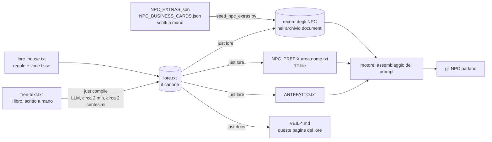
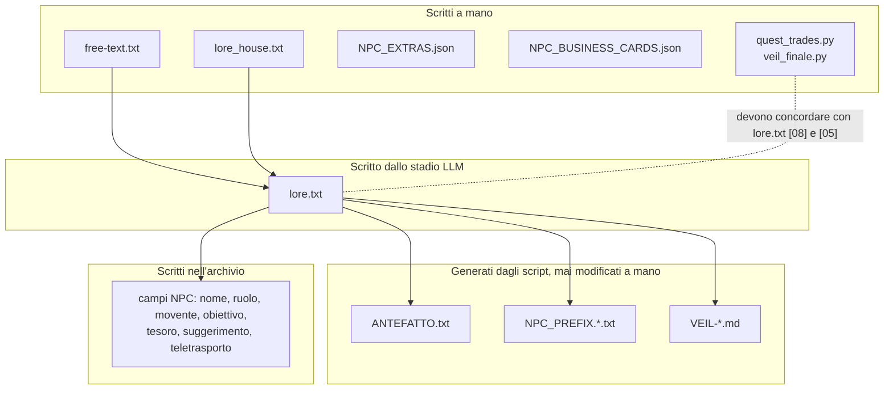

# La pipeline del lore

[Tutti i progetti](../README.md) · [Nexus](README.md) · Motore: [panoramica](ENGINE.md), [flusso delle richieste](ENGINE-REQUEST-FLOW.md), [comandi](ENGINE-COMMANDS.md), [prompt](ENGINE-PROMPT.md), [meccaniche](ENGINE-MECHANICS.md), [storage e configurazione](ENGINE-STORAGE-CONFIG.md) · Pipeline: [panoramica](PIPELINE.md), [digest](PIPELINE-DIGEST.md), [derivazione](PIPELINE-DERIVE.md) · Lore: [il Velo](VEIL.md), [mondo](VEIL-WORLD.md), [luoghi](VEIL-PLACES.md), [NPC](VEIL-NPCS.md), [fazioni](VEIL-FACTIONS.md), [missioni](VEIL-MISSIONS.md)

Un solo canone, molti consumatori. La storia si scrive una volta come testo libero; un LLM la distilla in `lore.txt`; degli script
ricavano da quel file tutto ciò che legge il gioco. Dettagli di ogni stadio: [digest](PIPELINE-DIGEST.md) e
[derivazione](PIPELINE-DERIVE.md). Com'è il risultato: le [pagine del lore](VEIL-WORLD.md).

## Comandi

| Comando | Legge | Scrive | LLM |
|---|---|---|---|
| `just compile free-text.txt` | il testo libero, `lore_house.txt`, il `lore.txt` precedente e i record NPC | `lore.txt` (il vecchio resta come `lore.txt.bak-<ora>`) | sì |
| `just lore` | `lore.txt` | `ANTEFATTO.txt`, `NPC_PREFIX.*.txt`, i campi NPC cambiati (record salvati prima) | no |
| `just lore --no-npcs` | `lore.txt` | i due file qui sopra; per i record NPC segnala soltanto le differenze | no |
| `just lore --check` | `lore.txt` | niente; esce con 1 se un file generato non è aggiornato | no |
| `just docs` | `lore.txt` | `VEIL-*.md` in questa cartella | no |
| `python seed_npc_extras.py` | i due file JSON | biglietti, notecard e teletrasporti nell'archivio | no |

Esegui `just compile` solo quando cambia `free-text.txt`: il modello formula le cose in modo leggermente diverso a ogni
esecuzione, quindi ricompilare una sorgente invariata riscrive `lore.txt` e tutti i prefissi. `just lore` e `just docs` sono
deterministici.

## Chi possiede quale file

`quest_trades.py` e `veil_finale.py` citano codici NPC (`NPC.village.mara`, `NPC.ancientruins.syra`, …), quindi quei codici non
devono cambiare quando si ricompila il lore; lo stadio di digest li mantiene stabili
([come](PIPELINE-DIGEST.md#mantenere-stabili-gli-identificatori)).

## Garanzie

- `lore.txt` viene sostituito solo se il nuovo testo supera la validazione; altrimenti la bozza resta in `lore.txt.failed`.
- Ogni scrittura nell'archivio è preceduta da un backup dei record NPC (`database/backups/NPCs-before-compile-lore-*.json`) e si
  scrivono solo i campi che differiscono davvero; accenti, virgolette e spaziatura non contano come differenze.
- I file di prompt generati vengono eliminati quando nessun NPC vi corrisponde più.
- Gli script non contengono gestione grammaticale: i nomi si confrontano come stringhe esatte, ed è lo stadio LLM a farli coincidere.

## Lacune note

- `SYSPROMPT.toml` e `NARRATIVE_FRAMEWORK.txt` descrivono ancora un vecchio mondo "Cyberspazio"; non sono ancora generati da
  `lore.txt` e possono far uscire parole che il lore vieta (vedi i [termini](VEIL-WORLD.md#termini)).
- Sette notecard di NPC (Syra, Theron, Elira, Erasmus, Boros, Lyra, Jorin) vengono da una versione più vecchia della storia.
- `just lore` aggiorna i file JSON in `database/` a meno che sia impostato `NEXUS_STORAGE=sqlite NEXUS_SQLITE_PATH=…`, mentre il
  server legge SQLite; `start_nexus.sh` usa `database/nexus.db`.
- Le domande aperte nel canone stesso (per esempio come i Sussurri si rapportino agli Oblivianti) sono elencate in `lore.txt` [11] e
  restano volutamente irrisolte.

## Cambiare una storia

1. Modifica `free-text.txt`.
2. `just compile free-text.txt`, poi leggi `[11 PUNTI APERTI]` nel nuovo `lore.txt`.
3. `just lore --no-npcs` per un'anteprima, poi `just lore`; `just docs` per queste pagine.
4. Verifica che `quest_trades.py` e `veil_finale.py` corrispondano ancora ai codici del lore, poi riavvia (`./start_nexus.sh`).
