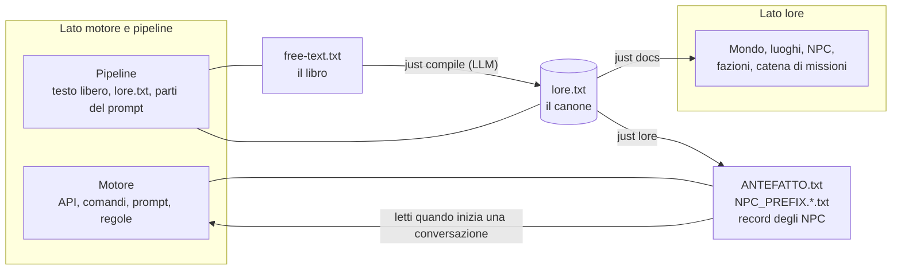

# Nexus

[Tutti i progetti](../README.md) · [Nexus](README.md) · Motore: [panoramica](ENGINE.md), [flusso delle richieste](ENGINE-REQUEST-FLOW.md), [comandi](ENGINE-COMMANDS.md), [prompt](ENGINE-PROMPT.md), [meccaniche](ENGINE-MECHANICS.md), [storage e configurazione](ENGINE-STORAGE-CONFIG.md) · Pipeline: [panoramica](PIPELINE.md), [digest](PIPELINE-DIGEST.md), [derivazione](PIPELINE-DERIVE.md) · Lore: [il Velo](VEIL.md), [mondo](VEIL-WORLD.md), [luoghi](VEIL-PLACES.md), [NPC](VEIL-NPCS.md), [fazioni](VEIL-FACTIONS.md), [missioni](VEIL-MISSIONS.md)

Un motore di RPG testuale basato sull'intelligenza artificiale. I giocatori parlano con NPC guidati da un LLM nel mondo di
**Eldoria** ("The Weaving Veil"); il motore tiene conversazioni, inventari e un profilo del giocatore, fa rispettare le regole
delle missioni sul server e può far vivere gli stessi NPC dentro OpenSim / Second Life. Repository:
[github.com/pakkio/nexus](https://github.com/pakkio/nexus) · il README del codice è [`../../README.md`](../../README.md).

Questa cartella documenta Nexus da **due lati** che si incontrano in un solo file, `lore.txt`:

## Lato motore e pipeline — come funziona

| Pagina | A quale domanda risponde |
|---|---|
| [Panoramica del motore](ENGINE.md) | Quali componenti esistono e come si collegano |
| [Flusso delle richieste](ENGINE-REQUEST-FLOW.md) | Cosa succede, passo per passo, quando un giocatore manda un messaggio |
| [Comandi](ENGINE-COMMANDS.md) | I comandi di gioco e quelli per sviluppatori (`just`, script, test) |
| [Assemblaggio del prompt](ENGINE-PROMPT.md) | Cosa entra nel prompt di sistema di un NPC, e da quale file |
| [Meccaniche di gioco](ENGINE-MECHANICS.md) | Tag, scambi, scelta finale, notecard, teletrasporti |
| [Storage e configurazione](ENGINE-STORAGE-CONFIG.md) | Archivi, modelli, ambiente, script di avvio |
| [La pipeline del lore](PIPELINE.md) | I due stadi, i comandi e le garanzie |
| [Stadio 1: digest](PIPELINE-DIGEST.md) | Come un LLM trasforma il testo libero in `lore.txt` |
| [Stadio 2: derivazione](PIPELINE-DERIVE.md) | Come `lore.txt` diventa parti del prompt, record NPC e queste pagine |

## Lato lore — com'è il mondo

| Pagina | Cosa contiene |
|---|---|
| [Il Velo](VEIL.md) | La storia in breve: com'è nato il mondo e cosa è in gioco |
| [Mondo](VEIL-WORLD.md) | La sezione del mondo nel canone, i termini, cosa può sapere un NPC |
| [Luoghi](VEIL-PLACES.md) | Ogni luogo, il livello di accesso e i residenti |
| [NPC](VEIL-NPCS.md) | Tutti: ruolo, movente, obiettivo, posizione nella catena |
| [Fazioni e finale](VEIL-FACTIONS.md) | Le tre vie, i loro costi, come si raggiunge il finale |
| [La catena di missioni](VEIL-MISSIONS.md) | Chi dà cosa, in cambio di cosa |

Le pagine del lore sono generate da `lore.txt` (`just docs`) e non si modificano a mano.
