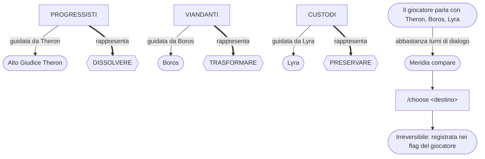

# Lore: fazioni e finale

[Tutti i progetti](../README.md) · [Nexus](README.md) · Motore: [panoramica](ENGINE.md), [flusso delle richieste](ENGINE-REQUEST-FLOW.md), [comandi](ENGINE-COMMANDS.md), [prompt](ENGINE-PROMPT.md), [meccaniche](ENGINE-MECHANICS.md), [storage e configurazione](ENGINE-STORAGE-CONFIG.md) · Pipeline: [panoramica](PIPELINE.md), [digest](PIPELINE-DIGEST.md), [derivazione](PIPELINE-DERIVE.md) · Lore: [il Velo](VEIL.md), [mondo](VEIL-WORLD.md), [luoghi](VEIL-PLACES.md), [NPC](VEIL-NPCS.md), [fazioni](VEIL-FACTIONS.md), [missioni](VEIL-MISSIONS.md)

> Generato da `lore.txt` con `build_docs.py` (`just docs`). Non modificare a mano: modifica il lore e rigenera.

Chi guida cosa, quanto costa ogni via e come si arriva al finale (`lore.txt` [05]).



## Fazioni e costi

```text
- CUSTODI, Custodi della Memoria.
   Chi è: fazione guidata dalla Tessitrice Lyra.
   Vuole: ricostruire completamente la storia dei Tessitori e del loro sacrificio per rinnovare il Velo, cercando i Nodi Primordiali dove la memoria del Sacrificio è ancora intatta.
   Destino che rappresenta: preservare il Velo.
 - PROGRESSISTI, Progressisti.
   Chi è: fazione sotto l'influenza dell'Alto Giudice Theron.
   Vuole: permettere al Velo di dissolversi e affrontare gli Oblivianti con tecnologia e forza di volontà moderni; vede il Velo come una reliquia del passato che ostacola l'evoluzione umana.
   Destino che rappresenta: dissolvere il Velo.
 - VIANDANTI, Viandanti dell'Equilibrio.
   Chi è: ordine monastico guidato dall'anziano Boros.
   Vuole: trasformare il Velo, evolvendolo in qualcosa di nuovo che onori il passato senza imprigionare il futuro; non preservarlo né distruggerlo.
   Destino che rappresenta: trasformare il Velo.
Costi irreversibili delle vie:
 - PRESERVARE: ricostruire la storia dei Tessitori e rinnovare il Velo.
   Costo dedotto: mantenere il peso del Sacrificio Originale e il paradosso di una protezione che può imprigionare il futuro; la scelta è irreversibile. (da confermare)
 - DISSOLVERE: lasciare che il Velo si dissolva e affrontare gli Oblivianti con tecnologia e forza di volontà moderni.
   Costo dedotto: accettare l'oblio e la perdita della memoria collettiva protetta dal Velo, con il rischio che i Sussurri dell'Oblio cancellino ricordi e identità; la scelta è irreversibile. (da confermare)
 - TRASFORMARE: evolvere il Velo in qualcosa di nuovo che onori il passato senza imprigionare il futuro.
   Costo dedotto: rinunciare sia alla preservazione integrale sia alla dissoluzione, accettando che il Velo cambi e che il passato non resti intatto; la scelta è irreversibile. (da confermare)
Incompatibilita (non vanno mai ricomposte): Lyra, Theron e Boros non si conciliano: le loro vie sono preservare, dissolvere e trasformare il Velo, e il sorgente le presenta come fazioni in conflitto filosofico.
FINALE: Meridia non si mostra finché il Cercatore non ha parlato davvero, non solo scambiato oggetti, con i tre capi fazione Lyra, Theron e Boros, almeno tre turni di dialogo ciascuno. Poi il Cercatore sceglie con il comando /choose preserve, dissolve o transform; la scelta è irreversibile. Meridia non sceglie per lui, non lo spinge e non giudica: espone le tre vie con il loro prezzo. Il suo oggetto è Il Telaio del Nuovo Inizio, che attua qualsiasi decisione. Il giocatore è il Cercatore, mai Cercastorie.
```

## La scelta finale

FINALE: Meridia non si mostra finché il Cercatore non ha parlato davvero, non solo scambiato oggetti, con i tre capi fazione Lyra, Theron e Boros, almeno tre turni di dialogo ciascuno. Poi il Cercatore sceglie con il comando /choose preserve, dissolve o transform; la scelta è irreversibile. Meridia non sceglie per lui, non lo spinge e non giudica: espone le tre vie con il loro prezzo. Il suo oggetto è Il Telaio del Nuovo Inizio, che attua qualsiasi decisione. Il giocatore è il Cercatore, mai Cercastorie.

Lato motore: il cancello e il destino registrato stanno in `veil_finale.py` — vedi [meccaniche](ENGINE-MECHANICS.md#la-scelta-finale).
