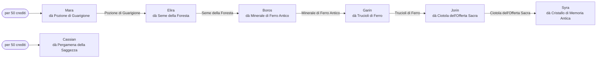

# Lore: la catena di missioni

[Tutti i progetti](../README.md) · [Nexus](README.md) · Motore: [panoramica](ENGINE.md), [flusso delle richieste](ENGINE-REQUEST-FLOW.md), [comandi](ENGINE-COMMANDS.md), [prompt](ENGINE-PROMPT.md), [meccaniche](ENGINE-MECHANICS.md), [storage e configurazione](ENGINE-STORAGE-CONFIG.md) · Pipeline: [panoramica](PIPELINE.md), [digest](PIPELINE-DIGEST.md), [derivazione](PIPELINE-DERIVE.md) · Lore: [il Velo](VEIL.md), [mondo](VEIL-WORLD.md), [luoghi](VEIL-PLACES.md), [NPC](VEIL-NPCS.md), [fazioni](VEIL-FACTIONS.md), [missioni](VEIL-MISSIONS.md)

> Generato da `lore.txt` con `build_docs.py` (`just docs`). Non modificare a mano: modifica il lore e rigenera.

Chi dà cosa, in cambio di cosa (`lore.txt` [08]).

| # | NPC | Dà | Costo | Nella catena |
|---|---|---|---|---|
| 1 | [Mara](VEIL-NPCS.md#mara) | Pozione di Guarigione | per 50 crediti | sì |
| 2 | [Elira](VEIL-NPCS.md#elira) | Seme della Foresta | in cambio di Pozione di Guarigione | sì |
| 3 | [Boros](VEIL-NPCS.md#boros) | Minerale di Ferro Antico | in cambio di Seme della Foresta | sì |
| 4 | [Garin](VEIL-NPCS.md#garin) | Trucioli di Ferro | in cambio di Minerale di Ferro Antico | sì |
| 5 | [Jorin](VEIL-NPCS.md#jorin) | Ciotola dell'Offerta Sacra | in cambio di Trucioli di Ferro | sì |
| 6 | [Syra](VEIL-NPCS.md#syra) | Cristallo di Memoria Antica | in cambio di Ciotola dell'Offerta Sacra | sì |
| 7 | [Cassian](VEIL-NPCS.md#cassian) | Pergamena della Saggezza | per 50 crediti | no |

Nota: il Cristallo di Memoria Antica serve a Lyra.

## Regole

Regole: La catena segue l'ordine sopra: Mara vende la Pozione di Guarigione per 50 crediti; Elira dà il Seme della Foresta in cambio di una Pozione di Guarigione; Boros dà il Minerale di Ferro Antico in cambio di un Seme della Foresta; Garin dà i Trucioli di Ferro in cambio di un Minerale di Ferro Antico; Jorin dà la Ciotola dell'Offerta Sacra in cambio di Trucioli di Ferro; Syra dà il Cristallo di Memoria Antica in cambio di una Ciotola dell'Offerta Sacra. Cassian, fuori dalla catena, vende la Pergamena della Saggezza per 50 crediti. L'oggetto passa solo dopo consegna o pagamento.

Lato motore: il server accetta solo questi scambi (`quest_trades.py`) — vedi [meccaniche](ENGINE-MECHANICS.md#scambi).
