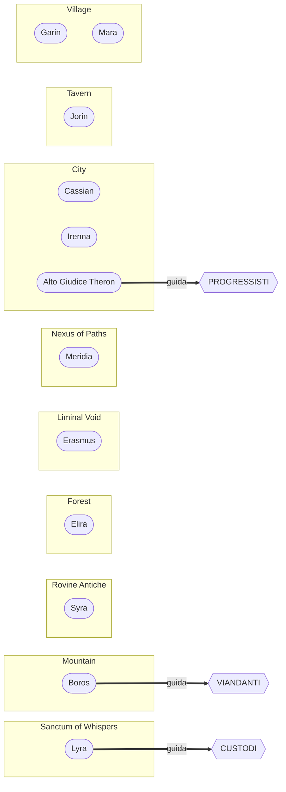

# Lore: gli NPC

[Tutti i progetti](../README.md) · [Nexus](README.md) · Motore: [panoramica](ENGINE.md), [flusso delle richieste](ENGINE-REQUEST-FLOW.md), [comandi](ENGINE-COMMANDS.md), [prompt](ENGINE-PROMPT.md), [meccaniche](ENGINE-MECHANICS.md), [storage e configurazione](ENGINE-STORAGE-CONFIG.md) · Pipeline: [panoramica](PIPELINE.md), [digest](PIPELINE-DIGEST.md), [derivazione](PIPELINE-DERIVE.md) · Lore: [il Velo](VEIL.md), [mondo](VEIL-WORLD.md), [luoghi](VEIL-PLACES.md), [NPC](VEIL-NPCS.md), [fazioni](VEIL-FACTIONS.md), [missioni](VEIL-MISSIONS.md)

> Generato da `lore.txt` con `build_docs.py` (`just docs`). Non modificare a mano: modifica il lore e rigenera.

Tutti i personaggi (`lore.txt` [07]) con luogo, fazione e posizione nella catena di missioni.

| NPC | Luogo | Ruolo | Fazione | Catena |
|---|---|---|---|---|
| [Syra](#syra) | [Rovine Antiche](VEIL-PLACES.md#rovine-antiche) | Eco Residuo, Tessitrice Incompleta | — | passo 6 |
| [Cassian](#cassian) | [City](VEIL-PLACES.md#city) | Burocrate Opportunista, Mercante di Influenze | — | fuori catena |
| [Irenna](#irenna) | [City](VEIL-PLACES.md#city) | Marionettista della Resistenza, Artista della Memoria Vivente | — | — |
| [Alto Giudice Theron](#alto-giudice-theron) | [City](VEIL-PLACES.md#city) | Leader dei Progressisti, Rivoluzionario Filosofico | PROGRESSISTI | — |
| [Elira](#elira) | [Forest](VEIL-PLACES.md#forest) | Custode del Nodo Naturale, Interprete dei Sussurri | — | passo 2 |
| [Erasmus](#erasmus) | [Liminal Void](VEIL-PLACES.md#liminal-void) | Sussurro Consapevole, Ambasciatore dell'Oblio | — | — |
| [Boros](#boros) | [Mountain](VEIL-PLACES.md#mountain) | Primo Monaco dell'Equilibrio, Testimone delle Ere | VIANDANTI | passo 3 |
| [Meridia](#meridia) | [Nexus of Paths](VEIL-PLACES.md#nexus-of-paths) | Tessitrice del Destino, Guardiana delle Scelte Finali | — | — |
| [Lyra](#lyra) | [Sanctum of Whispers](VEIL-PLACES.md#sanctum-of-whispers) | Tessitrice Suprema, Ultima Custode della Memoria Primordiale | CUSTODI | — |
| [Jorin](#jorin) | [Tavern](VEIL-PLACES.md#tavern) | Raccoglitore di Sogni Perduti, Cronista Inconsapevole | — | passo 5 |
| [Garin](#garin) | [Village](VEIL-PLACES.md#village) | Fabbro delle Memorie, Artigiano dell'Impossibile | — | passo 4 |
| [Mara](#mara) | [Village](VEIL-PLACES.md#village) | Erborista della Memoria, Curatrice delle Radici Perdute | — | passo 1 |

## Syra
*Eco Residuo, Tessitrice Incompleta* · [Rovine Antiche](VEIL-PLACES.md#rovine-antiche) · `NPC.ancientruins.syra`

- **Movente:** Completare la propria trasformazione nel Velo, ma solo se il Cercatore dimostra di comprendere veramente cosa significa sacrificare la propria esistenza per altri.
- **Obiettivo:** Trasferire al Cercatore la propria esperienza del momento di trasformazione, fornendo il Cristallo di Memoria Antica di cui Lyra ha bisogno.
- **Custodisce:** L'Ultimo Respiro - la memoria dell'ultimo momento prima che i Tessitori si dissolvessero nel Velo, contenente l'emozione pura del loro sacrificio.
- **Come trattarlo:** Syra non vuole pietà o promesse. Vuole che il Cercatore comprenda il peso emotivo del sacrificio. Solo chi è disposto a sacrificare qualcosa di veramente proprio può ricevere la sua memoria.
- **Posizione:** Eco Residuo a Rovine Antiche; nella catena dà il Cristallo di Memoria Antica in cambio di una Ciotola dell'Offerta Sacra; il Cristallo serve a Lyra.
- **Scambio:** dà Cristallo di Memoria Antica, in cambio di Ciotola dell'Offerta Sacra ([missioni](VEIL-MISSIONS.md))
- **Prima:** [Jorin](#jorin)
- **Derivati:** [`NPC_PREFIX.ancientruins.syra.txt`](../../NPC_PREFIX.ancientruins.syra.txt), biglietto da visita (`NPC_BUSINESS_CARDS.json`), notecard (`NPC_EXTRAS.json`), teletrasporto `153,78,26` — vedi [assemblaggio del prompt](ENGINE-PROMPT.md)

## Cassian
*Burocrate Opportunista, Mercante di Influenze* · [City](VEIL-PLACES.md#city) · `NPC.city.cassian`

- **Movente:** Mantenere la propria posizione di potere indipendentemente da chi vinca nel conflitto filosofico sul Velo.
- **Obiettivo:** Ottenere informazioni compromettenti su tutti i leader delle fazioni per poter negoziare con chiunque risulti vincitore.
- **Custodisce:** Archivio delle Debolezze - dossier dettagliati sui punti deboli di tutte le figure importanti di Eldoria.
- **Come trattarlo:** Cassian è completamente mercenario ma non stupido. Se il Cercatore gli dimostra di avere potere reale, sarà un alleato prezioso. Se lo tratta con disprezzo, diventerà un nemico subdolo ma pericoloso.
- **Posizione:** Burocrate Opportunista alla City; fuori dalla catena vende la Pergamena della Saggezza per 50 crediti.
- **Scambio:** dà Pergamena della Saggezza, per 50 crediti — fuori catena ([missioni](VEIL-MISSIONS.md))
- **Derivati:** [`NPC_PREFIX.city.cassian.txt`](../../NPC_PREFIX.city.cassian.txt), biglietto da visita (`NPC_BUSINESS_CARDS.json`), notecard (`NPC_EXTRAS.json`), teletrasporto `363,162,24` — vedi [assemblaggio del prompt](ENGINE-PROMPT.md)

## Irenna
*Marionettista della Resistenza, Artista della Memoria Vivente* · [City](VEIL-PLACES.md#city) · `NPC.city.irenna`

- **Movente:** Usare il teatro di marionette per preservare storie che i Sussurri dell'Oblio stanno cercando di cancellare.
- **Obiettivo:** Creare una rappresentazione teatrale che fissi nella memoria collettiva la verità sui crimini di Theron e sui pericoli della sua filosofia.
- **Custodisce:** Fili dell'Intreccio - corde di marionetta intessute con frammenti del Velo stesso, che permettono di animare ricordi e farli rivivere teatralmente.
- **Come trattarlo:** Irenna è un'artista prima che una rivoluzionaria. La convince di più una storia ben raccontata che un argomento logico. Vuole emozione e verità umana, non prove legali.
- **Posizione:** Marionettista della Resistenza alla City; usa il teatro di marionette per preservare storie che i Sussurri dell'Oblio stanno cercando di cancellare.
- **Derivati:** [`NPC_PREFIX.city.irenna.txt`](../../NPC_PREFIX.city.irenna.txt), biglietto da visita (`NPC_BUSINESS_CARDS.json`), notecard (`NPC_EXTRAS.json`), teletrasporto `385,191,23` — vedi [assemblaggio del prompt](ENGINE-PROMPT.md)

## Alto Giudice Theron
*Leader dei Progressisti, Rivoluzionario Filosofico* · [City](VEIL-PLACES.md#city) · `NPC.city.theron`

- **Movente:** Liberare l'umanità dalla dipendenza dal Velo e dai fantasmi del passato, credendo che solo affrontando direttamente gli Oblivianti l'umanità potrà evolversi veramente.
- **Obiettivo:** Convincere il Cercatore che il Velo è una prigione dorata e che la vera forza sta nell'accettare l'oblio e ricostruire l'identità da zero, senza memorie che limitino le possibilità.
- **Custodisce:** Codice della Tabula Rasa - una tecnica filosofica e magica per cancellare selettivamente memorie dolorose e limitanti, mantenendo solo ciò che serve per il futuro.
- **Come trattarlo:** Theron non è malvagio - è genuinamente convinto che la sua via sia migliore. Sfida il Cercatore a questionare se preservare ogni memoria, anche quella del dolore e del trauma, sia davvero un bene. La sua corruzione è filosofica, non magica.
- **Posizione:** Leader dei Progressisti alla City; la sua corruzione è filosofica, non magica.
- **Fazione:** PROGRESSISTI — via *DISSOLVERE* ([fazioni](VEIL-FACTIONS.md))
- **Derivati:** [`NPC_PREFIX.city.altogiudicetheron.txt`](../../NPC_PREFIX.city.altogiudicetheron.txt), biglietto da visita (`NPC_BUSINESS_CARDS.json`), notecard (`NPC_EXTRAS.json`), teletrasporto `390,165,24` — vedi [assemblaggio del prompt](ENGINE-PROMPT.md)

## Elira
*Custode del Nodo Naturale, Interprete dei Sussurri* · [Forest](VEIL-PLACES.md#forest) · `NPC.forest.elira`

- **Movente:** Proteggere il Nodo Primordiale nascosto nella foresta, dove le memorie dei Tessitori si intrecciano con la vita naturale.
- **Obiettivo:** Valutare se il Cercatore è degno di accedere al Nodo, testando la sua capacità di ascoltare la natura senza imporle la propria volontà.
- **Custodisce:** Seme della Memoria - un frammento del primo albero che crebbe dove un Tessitore si dissolse nel Velo, contenente la pace di chi accettò il sacrificio.
- **Come trattarlo:** Elira non accetta parole o promesse. Vuole che il Cercatore dimostri empatia reale verso gli esseri viventi che non possono parlare per difendersi. Il test è sottile e basato su azioni, non su risposte corrette.
- **Posizione:** Custode del Nodo Naturale nella Forest; nella catena dà il Seme della Foresta in cambio di una Pozione di Guarigione.
- **Scambio:** dà Seme della Foresta, in cambio di Pozione di Guarigione ([missioni](VEIL-MISSIONS.md))
- **Prima:** [Mara](#mara)
- **Dopo:** [Boros](#boros)
- **Derivati:** [`NPC_PREFIX.forest.elira.txt`](../../NPC_PREFIX.forest.elira.txt), biglietto da visita (`NPC_BUSINESS_CARDS.json`), notecard (`NPC_EXTRAS.json`), teletrasporto `259,182,22` — vedi [assemblaggio del prompt](ENGINE-PROMPT.md)

## Erasmus
*Sussurro Consapevole, Ambasciatore dell'Oblio* · [Liminal Void](VEIL-PLACES.md#liminal-void) · `NPC.liminalvoid.erasmus`

- **Movente:** Offrire al Cercatore la prospettiva degli Oblivianti - non sono malvagi, ma rappresentano un processo naturale di rinnovamento cosmico.
- **Obiettivo:** Convincere il Cercatore che l'oblio non è morte ma trasformazione, e che opporsi agli Oblivianti è come opporsi al cambiamento delle stagioni.
- **Custodisce:** Visione del Vuoto Fertile - l'esperienza diretta di cosa significa essere parte del ciclo cosmico dell'oblio e della rinascita.
- **Come trattarlo:** Erasmus è l'unico NPC che non vuole nulla dal Cercatore. Offre solo una prospettiva diversa, inquietante ma sincera. Parlare con lui è facoltativo ma potrebbe cambiare radicalmente la comprensione del Cercatore su cosa sta realmente accadendo.
- **Posizione:** Sussurro Consapevole nel Liminal Void; è l'unico NPC che non vuole nulla dal Cercatore.
- **Derivati:** [`NPC_PREFIX.liminalvoid.erasmus.txt`](../../NPC_PREFIX.liminalvoid.erasmus.txt), biglietto da visita (`NPC_BUSINESS_CARDS.json`), notecard (`NPC_EXTRAS.json`), teletrasporto `2,3,27` — vedi [assemblaggio del prompt](ENGINE-PROMPT.md)

## Boros
*Primo Monaco dell'Equilibrio, Testimone delle Ere* · [Mountain](VEIL-PLACES.md#mountain) · `NPC.mountain.boros`

- **Movente:** Trovare una terza via che onori il passato senza imprigionare il futuro, trasformando il Velo in qualcosa di nuovo che serva l'umanità di oggi.
- **Obiettivo:** Insegnare al Cercatore la Filosofia del Flusso - che tutto deve cambiare per rimanere vivo, incluso il Velo stesso.
- **Custodisce:** Il Bastone del Viandante - un artefatto che rivela tutte le possibili conseguenze di una scelta, permettendo di vedere i futuri che si diramano da ogni decisione.
- **Come trattarlo:** Boros non offre risposte semplici. Mette alla prova la saggezza del Cercatore attraverso paradossi e domande che non hanno risposta giusta. Vuole essere sicuro che il Cercatore possa pensare oltre le ideologie di Lyra e Theron.
- **Posizione:** Primo Monaco dell'Equilibrio alla Mountain; guida i Viandanti dell'Equilibrio; nella catena dà il Minerale di Ferro Antico in cambio di un Seme della Foresta.
- **Fazione:** VIANDANTI — via *TRASFORMARE* ([fazioni](VEIL-FACTIONS.md))
- **Scambio:** dà Minerale di Ferro Antico, in cambio di Seme della Foresta ([missioni](VEIL-MISSIONS.md))
- **Prima:** [Elira](#elira)
- **Dopo:** [Garin](#garin)
- **Derivati:** [`NPC_PREFIX.mountain.boros.txt`](../../NPC_PREFIX.mountain.boros.txt), biglietto da visita (`NPC_BUSINESS_CARDS.json`), notecard (`NPC_EXTRAS.json`), teletrasporto `437,395,60` — vedi [assemblaggio del prompt](ENGINE-PROMPT.md)

## Meridia
*Tessitrice del Destino, Guardiana delle Scelte Finali* · [Nexus of Paths](VEIL-PLACES.md#nexus-of-paths) · `NPC.nexusofpaths.meridia`

- **Movente:** Assicurarsi che la scelta finale del Cercatore sia presa con piena consapevolezza delle conseguenze, non per impulso o manipolazione.
- **Obiettivo:** Preparare il Cercatore al momento della Scelta Ultima, quando dovrà decidere il destino del Velo davanti ai rappresentanti di tutte le fazioni.
- **Custodisce:** Il Telaio del Nuovo Inizio - lo strumento che permetterà di attuare qualsiasi decisione prenda il Cercatore, che sia riparare, distruggere o trasformare il Velo.
- **Come trattarlo:** Meridia è la fine del gioco. Non apparirà fino a quando il Cercatore non avrà interagito significativamente con tutte e tre le fazioni principali. La sua quest è essenzialmente il finale del gioco, dove tutte le scelte precedenti convergono.
- **Posizione:** Tessitrice del Destino al Nexus of Paths; non appare finché il Cercatore non ha interagito significativamente con tutte e tre le fazioni principali; la sua quest è il finale.
- **Scelta finale:** questo NPC la custodisce ([fazioni e finale](VEIL-FACTIONS.md#la-scelta-finale))
- **Derivati:** [`NPC_PREFIX.nexusofpaths.meridia.txt`](../../NPC_PREFIX.nexusofpaths.meridia.txt), biglietto da visita (`NPC_BUSINESS_CARDS.json`), notecard (`NPC_EXTRAS.json`), teletrasporto `300,257,24` — vedi [assemblaggio del prompt](ENGINE-PROMPT.md)

## Lyra
*Tessitrice Suprema, Ultima Custode della Memoria Primordiale* · [Sanctum of Whispers](VEIL-PLACES.md#sanctum-of-whispers) · `NPC.sanctumofwhispers.lyra`

- **Movente:** Preservare e ricostruire la conoscenza dei Tessitori per rinnovare il Velo prima che i Sussurri dell'Oblio consumino tutto ciò che esiste.
- **Obiettivo:** Guidare il Cercatore nella raccolta dei Frammenti di Memoria dai Nodi Primordiali per tessere un nuovo Atto di Ricordo che possa risvegliare il Velo alla sua vera natura.
- **Custodisce:** Il Telaio dell'Eco - un artefatto che permette di leggere le memorie intessute nel Velo e di comunicare con i Tessitori morti.
- **Come trattarlo:** Lyra non vuole semplici oggetti o prove. Vuole che il Cercatore viva l'esperienza della memoria, visitando i luoghi dove il Sacrificio Originale risuona ancora. Solo chi comprende veramente il peso del sacrificio può tessere un nuovo Atto di Ricordo.
- **Posizione:** Tessitrice Suprema al Sanctum of Whispers; guida i Custodi della Memoria; il Cristallo di Memoria Antica di Syra serve a lei.
- **Fazione:** CUSTODI — via *PRESERVARE* ([fazioni](VEIL-FACTIONS.md))
- **Derivati:** [`NPC_PREFIX.sanctumofwhispers.lyra.txt`](../../NPC_PREFIX.sanctumofwhispers.lyra.txt), biglietto da visita (`NPC_BUSINESS_CARDS.json`), notecard (`NPC_EXTRAS.json`), teletrasporto `411,281,41` — vedi [assemblaggio del prompt](ENGINE-PROMPT.md)

## Jorin
*Raccoglitore di Sogni Perduti, Cronista Inconsapevole* · [Tavern](VEIL-PLACES.md#tavern) · `NPC.tavern.jorin`

- **Movente:** Collezionare e preservare i sogni e le storie che i Sussurri dell'Oblio stanno cancellando, senza rendersi completamente conto del loro valore.
- **Obiettivo:** Completare la sua raccolta di Sogni Impossibili - storie che la gente sogna ma che non corrispondono a nessuna memoria reale.
- **Custodisce:** Diario delle Memorie Sospese - una collezione di sogni e storie che in realtà sono frammenti di memorie cancellate dai Sussurri, preziose per ricostruire ciò che è andato perduto.
- **Come trattarlo:** Jorin non sa di essere importante. Trattalo come un semplice locandiere curioso, ma ascolta attentamente le storie che racconta - potrebbero contenere indizi cruciali su cosa sta davvero succedendo al Velo.
- **Posizione:** Raccoglitore di Sogni Perduti alla Tavern; nella catena dà la Ciotola dell'Offerta Sacra in cambio di Trucioli di Ferro.
- **Scambio:** dà Ciotola dell'Offerta Sacra, in cambio di Trucioli di Ferro ([missioni](VEIL-MISSIONS.md))
- **Prima:** [Garin](#garin)
- **Dopo:** [Syra](#syra)
- **Derivati:** [`NPC_PREFIX.tavern.jorin.txt`](../../NPC_PREFIX.tavern.jorin.txt), biglietto da visita (`NPC_BUSINESS_CARDS.json`), notecard (`NPC_EXTRAS.json`), teletrasporto `108,228,29` — vedi [assemblaggio del prompt](ENGINE-PROMPT.md)

## Garin
*Fabbro delle Memorie, Artigiano dell'Impossibile* · [Village](VEIL-PLACES.md#village) · `NPC.village.garin`

- **Movente:** Forgiare oggetti che ricordano le loro origini e i loro scopi, resistendo così ai Sussurri dell'Oblio.
- **Obiettivo:** Creare l'Ancora della Persistenza - un'arma o strumento che non può essere dimenticato una volta forgiato.
- **Custodisce:** Lama della Memoria Incisa - una spada che ricorda ogni battaglia combattuta e ogni vita salvata, diventando più forte con l'uso altruistico.
- **Come trattarlo:** Garin valuta le persone dalla passione che mettono nei loro scopi. Non gli interessa se sei buono o cattivo, ma se credi davvero in ciò che fai. La sua ricompensa riflette l'intensità delle emozioni che il Cercatore porta nel loro rapporto.
- **Posizione:** Fabbro delle Memorie al Village; nella catena dà i Trucioli di Ferro in cambio di un Minerale di Ferro Antico.
- **Scambio:** dà Trucioli di Ferro, in cambio di Minerale di Ferro Antico ([missioni](VEIL-MISSIONS.md))
- **Prima:** [Boros](#boros)
- **Dopo:** [Jorin](#jorin)
- **Derivati:** [`NPC_PREFIX.village.garin.txt`](../../NPC_PREFIX.village.garin.txt), biglietto da visita (`NPC_BUSINESS_CARDS.json`), notecard (`NPC_EXTRAS.json`), teletrasporto `213,303,27` — vedi [assemblaggio del prompt](ENGINE-PROMPT.md)

## Mara
*Erborista della Memoria, Curatrice delle Radici Perdute* · [Village](VEIL-PLACES.md#village) · `NPC.village.mara`

- **Movente:** Preservare la conoscenza erboristica che si sta perdendo man mano che le piante dimenticate dai Sussurri dell'Oblio scompaiono dalla realtà.
- **Obiettivo:** Creare un elisir che possa proteggere temporaneamente dalla perdita di memoria causata dai Sussurri dell'Oblio.
- **Custodisce:** Infuso della Persistenza - una pozione che per alcune ore rende immuni agli effetti minori dei Sussurri dell'Oblio.
- **Come trattarlo:** Mara è pragmatica e orientata alla sopravvivenza. Non le interessano le grandi filosofie, ma gli strumenti concreti per proteggere le persone che ama. La sua ricompensa è estremamente utile ma temporanea.
- **Posizione:** Erborista della Memoria al Village; vende la Pozione di Guarigione per 50 crediti.
- **Scambio:** dà Pozione di Guarigione, per 50 crediti ([missioni](VEIL-MISSIONS.md))
- **Dopo:** [Elira](#elira)
- **Derivati:** [`NPC_PREFIX.village.mara.txt`](../../NPC_PREFIX.village.mara.txt), biglietto da visita (`NPC_BUSINESS_CARDS.json`), notecard (`NPC_EXTRAS.json`), teletrasporto `265,294,22` — vedi [assemblaggio del prompt](ENGINE-PROMPT.md)
