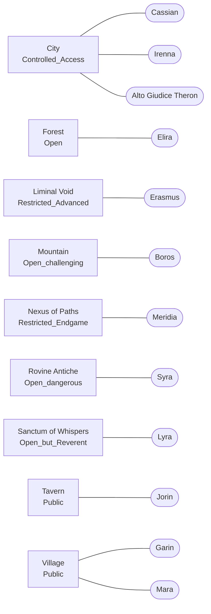

# Lore: i luoghi

[Tutti i progetti](../README.md) · [Nexus](README.md) · Motore: [panoramica](ENGINE.md), [flusso delle richieste](ENGINE-REQUEST-FLOW.md), [comandi](ENGINE-COMMANDS.md), [prompt](ENGINE-PROMPT.md), [meccaniche](ENGINE-MECHANICS.md), [storage e configurazione](ENGINE-STORAGE-CONFIG.md) · Pipeline: [panoramica](PIPELINE.md), [digest](PIPELINE-DIGEST.md), [derivazione](PIPELINE-DERIVE.md) · Lore: [il Velo](VEIL.md), [mondo](VEIL-WORLD.md), [luoghi](VEIL-PLACES.md), [NPC](VEIL-NPCS.md), [fazioni](VEIL-FACTIONS.md), [missioni](VEIL-MISSIONS.md)

> Generato da `lore.txt` con `build_docs.py` (`just docs`). Non modificare a mano: modifica il lore e rigenera.

Tutti i luoghi del canone (`lore.txt` [06]) e gli NPC che vi abitano.

| Luogo | Id | Accesso | Residenti |
|---|---|---|---|
| [City](#city) | `city` | Controlled_Access | [Cassian](VEIL-NPCS.md#cassian), [Irenna](VEIL-NPCS.md#irenna), [Alto Giudice Theron](VEIL-NPCS.md#alto-giudice-theron) |
| [Forest](#forest) | `forest` | Open | [Elira](VEIL-NPCS.md#elira) |
| [Liminal Void](#liminal-void) | `liminalvoid` | Restricted_Advanced | [Erasmus](VEIL-NPCS.md#erasmus) |
| [Mountain](#mountain) | `mountain` | Open_challenging | [Boros](VEIL-NPCS.md#boros) |
| [Nexus of Paths](#nexus-of-paths) | `nexusofpaths` | Restricted_Endgame | [Meridia](VEIL-NPCS.md#meridia) |
| [Rovine Antiche](#rovine-antiche) | `ancientruins` | Open_dangerous | [Syra](VEIL-NPCS.md#syra) |
| [Sanctum of Whispers](#sanctum-of-whispers) | `sanctumofwhispers` | Open_but_Reverent | [Lyra](VEIL-NPCS.md#lyra) |
| [Tavern](#tavern) | `tavern` | Public | [Jorin](VEIL-NPCS.md#jorin) |
| [Village](#village) | `village` | Public | [Garin](VEIL-NPCS.md#garin), [Mara](VEIL-NPCS.md#mara) |

## City

Accesso: `Controlled_Access` · id `city`

Metropoli imponente con grattacieli che si stagliano contro il Velo; la City domina lo skyline mentre la città bassa si estende ai suoi piedi. Grandi Occhi di sorveglianza sorvegliano ogni angolo, ma esistono sempre zone d'ombra dove i ribelli si nascondono. Legame col Velo: la città rappresenta il tentativo dell'umanità di controllare e sfruttare il Velo per il potere; i documenti burocratici resistono misteriosamente ai Sussurri dell'Oblio, creando un archivio involontario di memoria. Collegamenti: nexus_of_paths, sanctum_of_whispers, village_and_surrounding_areas, underground_resistance_network.

## Forest

Accesso: `Open` · id `forest`

Foresta antica e misteriosa dove alberi secolari si ergono come guardiani silenziosi; la luce del sole filtra attraverso le foglie creando giochi d'ombra sul terreno coperto di muschio, e il profumo di terra umida e resina si mescola al mormorio del vento tra le fronde. Legame col Velo: la foresta è un luogo dove il Velo si manifesta attraverso i sussurri del vento e le ombre che sembrano muoversi di vita propria; gli alberi più antichi custodiscono memorie di ere passate e chi sa ascoltare può sentire gli echi delle storie dimenticate. Collegamenti: village_outskirts, ancient_ruins_entrance, mountain_foothills, tavern_back_path.

## Liminal Void

Accesso: `Restricted_Advanced` · id `liminalvoid`

Spazio esistenziale che sfida ogni comprensione fisica: un'estensione infinita di nebbia opalescente dove il concetto stesso di direzione perde significato. Qui la realtà è fluida e frammenti di memorie perdute fluttuano come isole di luce in un mare di incertezza. Legame col Velo: è il cuore stesso del Velo, dove tutte le memorie dimenticate convergono prima di dissolversi nell'oblio; è qui che i frammenti di storie perdute cercano di ricomporsi e chi è abbastanza coraggioso può tentare di recuperare ciò che sembrava perduto per sempre. Collegamenti: nexus_of_paths_deep_access, sanctum_of_whispers_hidden_passage, ancient_ruins_secret_chamber, void_entrance_points.

## Mountain

Accesso: `Open_challenging` · id `mountain`

Imponenti vette rocciose che si ergono verso il cielo, con sentieri serpentini che si inerpicano tra dirupi e crepacci; l'aria è sottile e pura e il vento trasporta echi di antiche leggende. Caverne nascoste e altipiani custodiscono segreti di epoche remote, mentre il panorama offre una vista su tutto il mondo sottostante. Legame col Velo: le montagne sono pilastri che sostengono il Velo stesso, luoghi dove le memorie più profonde e durature trovano rifugio; le cime più alte toccano quasi il tessuto della realtà e chi le raggiunge può percepire la vastità delle storie che il Velo contiene. Collegamenti: forest_mountain_path, ancient_ruins_highland_entrance, village_mountain_trade_route, sky_bridges_to_nexus.

## Nexus of Paths

Accesso: `Restricted_Endgame` · id `nexusofpaths`

Crocevia mistico dove tutti i sentieri di Eldoria convergono; al centro si erge un antico cerchio di pietre coperte di rune, con Meridia che tesse al grande Telaio del Nuovo Inizio, e l'aria vibra di potenziale e destino. Legame col Velo: è il punto di maggiore tensione del Velo, dove tutte le linee di forza convergono; è qui che la scelta finale del Cercatore avrà effetto su tutto l'Yperverso. Collegamenti: all_major_locations_converge_here, sanctum_of_whispers_via_sacred_path, city_via_political_route, ancient_ruins_via_memory_path, mountain_via_wisdom_trail.

## Rovine Antiche

Accesso: `Open_dangerous` · id `ancientruins`

Resti maestosi di una civiltà perduta, dove colonne spezzate e archi crollati testimoniano una grandezza dimenticata; edera e muschio ricoprono le antiche sculture, stanze segrete si aprono nei sotterranei e il suono del vento tra le rovine sembra sussurrare segreti di epoche remote. Legame col Velo: le Rovine Antiche sono un epicentro di memorie stratificate, dove millenni di storia si sono sedimentati nel Velo; ogni pietra è impregnata di ricordi di una civiltà che comprendeva profondamente la natura del Velo stesso, e chi esplora questi luoghi può accedere a frammenti di conoscenza ancestrale. Collegamenti: ancient_ruins_main_site, forest_ruins_pathway, mountain_ancient_observatory, underground_passages_to_city.

## Sanctum of Whispers

Accesso: `Open_but_Reverent` · id `sanctumofwhispers`

Antico santuario costruito con pietre bianche che sembrano brillare di luce propria; grandi archi si aprono verso il cielo, il vento che passa attraverso le colonne produce suoni melodici e al centro si trova un altare tessitore coperto di simboli antichi. Legame col Velo: il Sanctum è uno dei punti dove il Velo è più sottile; qui Lyra può sentire direttamente i Sussurri dell'Oblio e comunicare con i Tessitori morti attraverso il tessuto stesso del Velo. Collegamenti: ancient_ruins_syra, nexus_of_paths_meridia, mountain_boros, pathways_to_all_areas.

## Tavern

Accesso: `Public` · id `tavern`

Taverna accogliente con tavoli di legno scuro, un focolare sempre acceso e scaffali pieni di bottiglie dai riflessi dorati; l'atmosfera è calda e invitante, con il profumo di cibo speziato e il mormorio di conversazioni. Legame col Velo: la taverna si trova su un punto di flusso delle memorie del Velo; i viaggiatori qui spesso hanno sogni vividi che sono echi di ricordi tessuti nel Velo stesso. Collegamenti: village_garin_forge, ancient_ruins_syra, paths_to_city, forest_edge.

## Village

Accesso: `Public` · id `village`

Pittoresco villaggio con case di pietra e legno dai tetti di paglia, dove il fumo sale placido dai camini e i giardini fioriti colorano le strade acciottolate; la vita scorre tranquilla tra botteghe artigiane, mercati locali e la piazza centrale dove i bambini giocano e gli anziani condividono storie al tramonto. Legame col Velo: il villaggio è costruito su un nodo di memorie quotidiane, dove i ricordi semplici della vita di tutti i giorni si intrecciano nel Velo; le tradizioni familiari e le storie tramandate di generazione in generazione creano un tessuto denso di memorie condivise che rafforzano la coesione della comunità. Collegamenti: tavern_village_center, forest_village_outskirts, mountain_trade_routes, paths_to_city.
